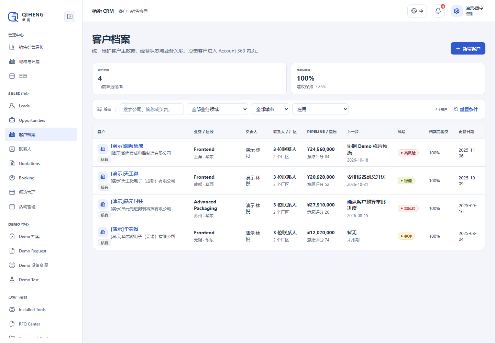
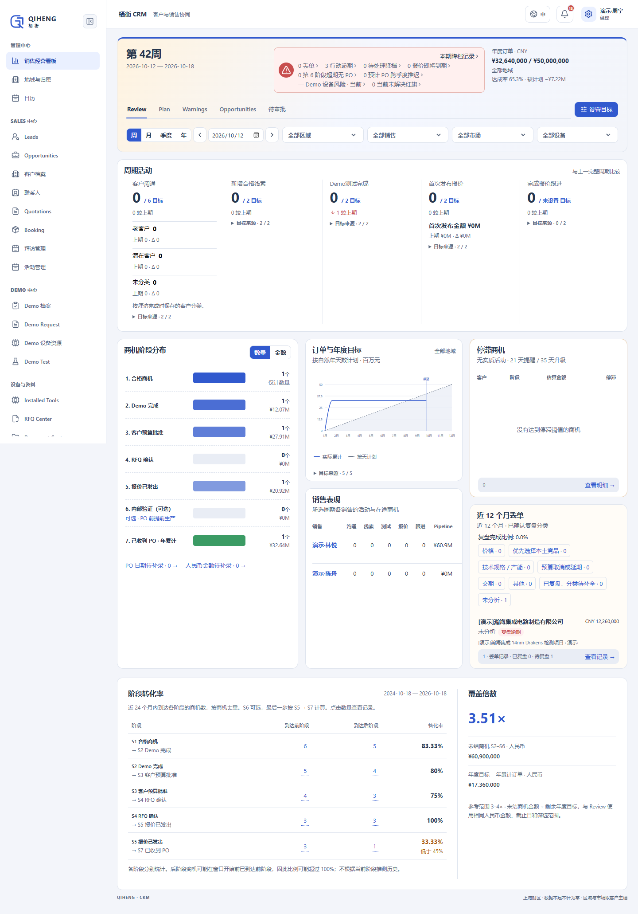

# 栖衡 CRM · QIHENG · 客户关系与销售管理

面向半导体设备业务的 CRM，将客户、商机、设备演示与验证、报价、订单和合同串联起来，支持销售、工程师与管理者协同推进业务。

**Vue 3 · TypeScript · Frappe / ERPNext 15 · MariaDB · Docker**

[功能概览](#功能概览) · [界面预览](#界面预览) · [运行项目](#运行项目) · [演示数据](#演示数据) · [工程实现](#工程实现)

## 功能概览

| 模块 | 核心功能 |
| --- | --- |
| 经营看板 | 周期活动、销售漏斗、订单与年度目标、阶段转化率、停滞商机与风险提醒 |
| 客户档案 | 客户、厂区、联系人、负责人及 Account 360 关联业务视图 |
| 线索与商机 | 需求、预算、阶段、概率、下一步行动和来源追溯 |
| 拜访与跟进 | 拜访计划、会议记录、客户互动与跟进行动 |
| Demo 与验证 | Demo 申请、工程评估、经理审批、设备资源与 Wafer Test 指标 |
| 报价与交付 | 报价、Booking、合同状态、到期提醒及已安装设备档案 |

**典型业务链：** 客户 / 线索 → 商机 → Demo 与验证 → 报价 → 客户 PO / Booking → 合同与设备档案。

## 界面预览

采用虚构品牌 **栖衡 QIHENG**，靛蓝色 CRM 工作台，统一导航、表格、按钮、登录页与浏览器图标。

### 客户档案

按负责人、区域和业务领域查看客户，集中呈现联系人、商机金额、下一步行动与风险。



<details>
<summary><strong>销售经营看板：查看界面</strong></summary>

从活动、商机阶段、年度目标与转化率几个维度查看销售进展。



</details>

截图来自已初始化的本地环境（2026-10-19），使用标有「演示」的虚构业务数据。

## 运行项目

完整系统需要 Frappe 后端。准备 **Docker Linux 引擎、Git、Node.js 22.12+、pnpm 11.9.0、PowerShell 7**，然后执行：

```powershell
git clone https://github.com/Meteor7/crm-system.git
cd crm-system
pnpm install --frozen-lockfile
```

接着按 [后端部署说明](backend/README.md#local-lifecycle) 完成前端构建、应用打包、镜像构建与 Compose 启动。

| 环境 | 访问入口 |
| --- | --- |
| 仓库默认模板 | [http://127.0.0.1:2224/crm](http://127.0.0.1:2224/crm)，站点 `rayher-crm.localhost` |
| 已有本地截图环境 | [http://127.0.0.1:8081/crm](http://127.0.0.1:8081/crm)，站点 `planck-crm.localhost` |

这些地址用于运行项目的本机。管理员为 `Administrator`；默认模板在首次启动时生成随机密码并保存在 Docker 凭据卷中，详见部署说明。

`pnpm dev` 提供前端开发服务，业务功能仍需 Frappe 后端与有效登录会话。

## 演示数据

[小规模演示脚本](backend/apps/rayher_crm/rayher_crm/setup/local_demo.py) 提供 **4 家客户、4 条线索、6 条商机、8 条拜访**，以及销售、经理、工程师各 2 个演示账号。

- 商机覆盖合格商机、Demo 完成、预算获批、报价、收到 PO 与丢单等状态。
- 脚本限定 `planck-crm.localhost`，通过 `seed(confirm="planck-crm.localhost")` 显式确认；发现已有演示客户时保留原有批次。
- 默认模板站点名不同，创建演示站点前需配置 `SITE_NAME`；演示用户密码由管理员另行设置。

推荐演示顺序：**客户档案 → 商机详情 → Demo 审批 → 报价 / Booking → 经营看板**。源码包含初始化脚本，业务数据保存在本地数据库。

## 工程实现

- **真实业务后端：** Frappe 会话、权限、DocType 与 MariaDB 持久化；前端通过 `rayher_crm.api.v1` 调用服务。
- **业务过程可追溯：** 关联客户、商机、验证与订单，支持角色审批和受控状态流转。
- **可验证交付：** TypeScript 类型检查、Vitest 测试、可复现打包，以及独立后端验收脚本。

```powershell
pnpm typecheck
pnpm test
pnpm build
```

GitHub CI 保留前端检查与打包，使用 GitHub 托管 Runner。依赖原服务器的后端任务及企业微信自动通知已移除；部署通过已有脚本按需执行。完整后端验证入口保留在 [发布检查说明](backend/README.md)。

## 文档与源码

| 入口 | 内容 |
| --- | --- |
| [操作手册](docs/crm-user-operation-manual.md) | 页面与业务使用说明 |
| [部署说明](backend/README.md) / [HTTPS 配置](deploy/nginx/README.md) | 启动、配置、日志与备份 |
| [人工验收清单](docs/CRM-功能验收QA清单-人工UAT.md) | 功能验收场景 |
| [前端](src/) / [后端](backend/apps/rayher_crm/) | 页面、API、权限、迁移与测试 |

本仓库保留 [原项目](https://github.com/kizzhang/PlanckSemicon_CRM/tree/codex/ui-component-polish) 的 Git 历史，用于项目展示与独立维护。

关联作品：[ERP / OA 企业运营与协同管理](https://github.com/Meteor7/erp-oa-system)。
