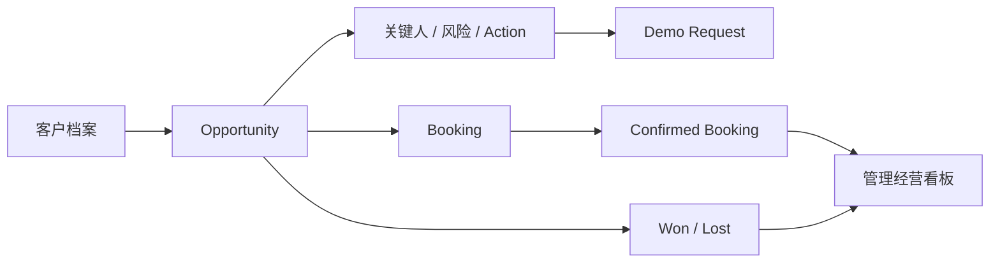
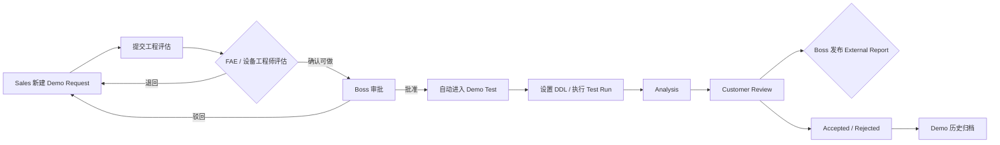
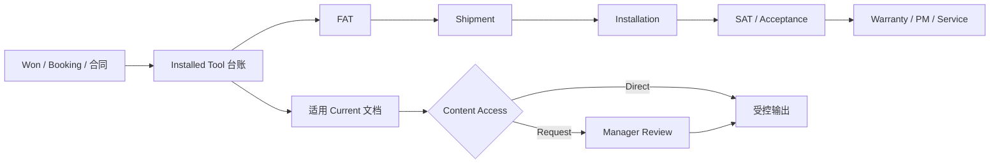

# Semiconductor CRM 用户操作手册

| 文档信息 | 内容 |
| --- | --- |
| 文档版本 | V1.0 |
| 编制日期 | 2026-07-23 |
| 适用系统 | Semiconductor CRM 局域网演示版 |
| 访问地址 | `http://203.0.113.10:4173/` |
| 适用对象 | Boss、Sales Manager、Sales、FAE / 应用工程师、设备工程师、CRM Administrator |
| 当前数据模式 | Mock 演示数据 |

> 本手册依据 2026-07-23 可访问的项目页面、角色权限和当前业务流程编写。当前地址是局域网演示预览，不代表真实 Frappe 后端、共享数据库和生产权限已经完成验收。

## 1. 系统简介

Semiconductor CRM 用于连接半导体设备销售、Demo 验证、设备交付和受控文档等业务。系统围绕客户建立统一业务档案，使销售、工程和管理层能够在同一客户上下文中查看商机、Booking、拜访、Demo、测试、Installed Tool 和相关文档。

系统当前包含四个业务区域：

| 业务区域 | 模块 |
| --- | --- |
| 管理中心 | 信息中心、Calendar |
| Sales 模块 | 客户档案、Opportunities & Booking、拜访与 Action |
| Demo 与验证 | Demo 档案、Demo Request、Demo Test |
| 设备与知识 | Installed Tools、Document Center |

### 1.1 核心业务目标

- 让管理层掌握 Pipeline、Booking、重点客户和团队执行情况。
- 让 Sales 从客户档案出发推进商机、拜访和 Demo Request。
- 让工程人员承接技术评估、Demo Test 和客户问题。
- 让已交付设备形成“一机一档”的客户现场设备台账。
- 让受控文档的目录可见性、内容访问和下载审计相互分离。

### 1.2 当前版本说明

当前版本使用 Mock 数据，主要用于页面演示、业务流程验证和用户培训：

- 页面顶部显示“Mock 数据已就绪／仅用于界面测试”。
- 不同浏览器或不同电脑之间的业务数据不保证实时共享。
- 当前页面中的身份切换用于模拟不同角色，不等同于正式登录。
- 正式环境仍需由 Frappe 后端执行身份认证、数据权限、状态校验、审计和文件访问控制。

## 2. 快速开始

### 2.1 打开系统

1. 确认电脑与 CRM 主机处于同一局域网。
2. 使用浏览器打开 `http://203.0.113.10:4173/`。
3. 等待页面左下角出现“Mock 数据已就绪”。
4. 查看右上角当前人员姓名和角色，确认进入了正确的操作视角。

**操作结果：** 系统根据当前角色展示可访问的菜单和业务数据。

> 演示环境当前没有独立登录页。正式 Frappe 环境的登录、密码和会话管理不属于本次演示验证范围。

### 2.2 切换 Demo 身份

1. 点击页面右上角的人员姓名或头像。
2. 在“切换员工视角”菜单中选择一个身份。
3. 等待页面出现“Demo 身份已切换为……”提示。
4. 检查左侧菜单和页面操作按钮是否随角色发生变化。

可选身份包括：

| Demo 人员 | 角色 | 数据范围 |
| --- | --- | --- |
| 演示员工24 | CRM Administrator | 全部数据和全部演示能力 |
| 演示经理01 | Boss / Management Viewer | 跨团队查看、Demo 审批和报告发布 |
| Demo Staff 06 | Sales Manager | 本销售团队 |
| Demo Staff 01 | Sales User | 本人负责业务 |
| 演示员工14 | FAE / 应用工程师 | 已分配客户和工程任务 |
| 演示员工15 | 设备工程师 | 已分配客户和设备验证任务 |

> CRM Administrator 仅用于 Demo 测试。当前页面明确提示该身份在生产上线后不存在。

### 2.3 通用页面操作

- **左侧导航：** 切换业务模块。
- **全局客户搜索：** 在顶部搜索客户公司、简称或负责人，提交后进入客户档案。
- **筛选条件：** 各列表页可以按客户、负责人、状态、业务领域或城市筛选。
- **立即刷新：** 数据提示为 `PARTIAL / STALE` 时，点击“立即刷新”重新读取。
- **Request ID：** 页面发生加载或权限错误时，用于问题追踪。
- **状态颜色：** 绿色通常表示完成或正常，黄色表示待处理或风险，红色表示失败、取消或拒绝。

## 3. 角色与权限

### 3.1 权限原则

系统权限包含两个不同概念：

1. **数据范围：** 用户能够看到哪些客户、团队和记录。
2. **操作能力：** 用户能否新增、编辑、审核、发布或执行。

看到记录不代表可以修改记录。页面不显示某个操作按钮时，通常表示当前角色没有该操作权限，或当前记录尚未进入允许操作的状态。

### 3.2 角色权限矩阵

| 功能 | Boss | Sales Manager | Sales | FAE | 设备工程师 | CRM Administrator |
| --- | :---: | :---: | :---: | :---: | :---: | :---: |
| 查看管理经营看板 | ✓ | — | — | — | — | ✓ |
| 查看个人提醒 | — | ✓ | ✓ | ✓ | ✓ | ✓ |
| 查看客户档案 | ✓ | ✓ | ✓ | ✓ | ✓ | ✓ |
| 新增／编辑客户 | — | ✓ | ✓ | — | — | ✓ |
| 导出客户报告 | ✓ | ✓ | ✓ | — | — | ✓ |
| 查看 Opportunity / Booking | ✓ | ✓ | ✓ | ✓ | ✓ | ✓ |
| 编辑 Opportunity / Booking | — | ✓ | ✓ | — | — | ✓ |
| 新建／推进拜访 | — | ✓ | ✓ | — | — | ✓ |
| 审核拜访 | — | ✓ | — | — | — | ✓ |
| 新建 Demo Request | — | ✓ | ✓ | — | — | ✓ |
| 工程评估 Demo Request | — | — | — | ✓ | ✓ | ✓ |
| 最终审批 Demo Request | ✓ | — | — | — | — | ✓ |
| 推进 Demo Test / Test Run | — | — | — | ✓ | ✓ | ✓ |
| 配置 External Report | — | ✓ | ✓ | — | — | — |
| 发布 External Report | ✓ | — | — | — | — | ✓ |
| 查看 Calendar | 全员／本人 | 本人 | 本人 | 本人及 Demo Test | 本人及 Demo Test | 全员／本人 |
| 查看 Installed Tools | ✓ | ✓ | ✓ | ✓ | ✓ | ✓ |
| 查看 Document Center | ✓ | ✓ | ✓ | ✓ | ✓ | ✓ |

> Boss 不是系统管理员。Boss 主要负责跨团队经营查看、Demo 最终审批和客户报告发布；经营数据和绝大多数业务主数据为只读。

## 4. 核心业务闭环

### 4.1 客户经营与订单闭环

### 4.2 Demo 验证闭环

### 4.3 设备与文档闭环

## 5. 管理中心

### 5.1 信息中心

**功能目的**

为管理层提供公司经营数据，为其他员工提供个人未来事项提醒。

**Boss 可查看的内容**

- Open Pipeline；
- Weighted Pipeline；
- Confirmed Booking；
- 累计 Closed Won；
- 全员近期 Calendar 安排；
- Calendar 和 Document Compliance；
- 实际 Booking 月度分布；
- 重点客户金额贡献；
- 团队业绩与管线；
- 展开后的客户结构、流程和执行分析。

**Boss 操作步骤**

1. 以“演示经理01／管理者权限”进入系统。
2. 点击左侧“信息中心”。
3. 检查数据截至时间和数据状态。
4. 如显示 `PARTIAL / STALE`，点击“立即刷新”。
5. 查看四项关键经营指标。
6. 在“重点事项与执行提醒”中点击某条安排，查看关联客户预期或 Demo Test DDL。
7. 点击“查看完整日历”进入 Calendar。
8. 点击“查看更多分析”展开客户、流程和执行图表。

**指标口径**

| 指标 | 口径 |
| --- | --- |
| Open Pipeline | 排除 Won 和 Lost 的全部开放商机金额 |
| Weighted Pipeline | 开放商机金额 × 当前赢率 |
| Confirmed Booking | 状态为 Confirmed 且存在 Booking Date 的记录 |
| 累计 Closed Won | 当前记录中状态为 Won 的商机金额 |

**其他角色**

Sales、FAE 和设备工程师进入“信息中心”后主要看到未来 15 天的个人提醒，而不是公司经营看板。

**注意事项**

- Boss 经营看板为只读。
- 数据过期时不要直接用于正式经营决策，应先刷新并核对数据来源。
- 当前图表来自 Mock 数据，不是共享数据库的实时经营报表。

### 5.2 Calendar

**功能目的**

统一汇总以下日期类事项：

- Sales 拜访；
- Demo Request 客户预期日期；
- Demo Test DDL；
- Booking DDL。

**操作步骤**

1. 点击左侧“Calendar”。
2. 使用“周／月”切换日历视图。
3. 点击“今天”返回当前日期。
4. 使用左右箭头切换上一周期或下一周期。
5. Boss 和 CRM Administrator 可在“我的安排／全员安排”之间切换。
6. 点击日历中的事项。
7. 在右侧查看事项类型、日期、客户、负责人和安排说明。

**操作结果**

Calendar 从上游业务模块读取日期。上游记录修改后，Calendar 将重新同步对应事项。

**注意事项**

- Calendar 当前主要用于查看，不在本页直接新建业务事项。
- 普通员工只能看到本人范围；工程人员还可看到分配给工程角色的 Demo Test。
- 当前 Calendar 是 Mock 演示视图，不应视为已经接入企业日历服务。

## 6. Sales 模块

### 6.1 客户档案

**功能目的**

以客户为中心查看 Account 360，包括 Site、关键人、采购需求、Opportunity、Booking、拜访、Demo、合同和行动。

**查看客户**

1. 点击左侧“客户档案”。
2. 在搜索框输入公司、简称或负责人。
3. 可按“业务领域”和“城市”进一步筛选。
4. 在左侧客户列表选择客户。
5. 在右侧查看 Account 360。

**Account 360 主要内容**

- Open Pipeline 与 Confirmed Booking；
- Site / 厂区；
- 关键人和组织关系；
- Opportunity 与 Booking；
- 采购需求与行动；
- 拜访与下一步；
- Demo / Wafer Test；
- 合同。

**新增客户（Sales／Sales Manager）**

1. 点击“新增客户”。
2. 填写客户名称、简称、业务领域、城市、区域、等级和负责人等信息。
3. 提交保存。
4. 返回客户列表搜索该客户，确认记录已出现。

**导出客户报告**

1. 选择目标客户。
2. 点击 Account 360 顶部的“导出客户报告”。
3. 浏览器下载客户报告 Excel 文件。
4. 打开文件核对客户名称、Pipeline、Booking 和关联记录。

**权限说明**

- Boss 可查看客户并导出报告，但不能新增或编辑客户。
- Sales Manager 查看团队范围并可维护客户。
- Sales 查看本人业务范围并可维护客户。
- 工程角色只能查看已分配客户的必要信息。

### 6.2 Opportunities & Booking

**功能目的**

在同一工作区维护销售机会和订单预期。Opportunity 描述商业机会及赢单策略，Booking 描述具体设备需求、数量、金额和客户 DDL。

#### 6.2.1 Opportunity

**新增 Opportunity（Sales／Sales Manager）**

1. 进入“Opportunities & Booking”。
2. 选择“Opportunities”标签。
3. 点击“新增 Opportunity”。
4. 填写以下核心信息：
   - Opportunity 名称；
   - 客户与厂区；
   - 负责人；
   - 阶段和预测分类；
   - 赢率和金额；
   - 预计 PO 日期；
   - 设备类型、销售类型；
   - 预计发货日期和 FAT 日期；
   - 竞争情况；
   - 付款节点、优势、风险和信息缺口。
5. 提交保存。
6. 在“重点商机”列表选择新记录并核对详情。

**维护赢单策略**

1. 选择一个 Opportunity。
2. 查看 Commercial Forecast 和 Change History。
3. 在 Buying Influence Coverage 中新增或编辑关键人。
4. 维护 Strength、Red Flag 和 Information Needed。
5. 在 Action Plan 中新增行动，指定 Owner 和 Due Date。
6. 行动完成后更新状态。

**Opportunity 阶段**

`需求发现 → 技术确认 → Demo 验证 → 报价 → 采购流程 → Won / Lost`

#### 6.2.2 Booking

**新增 Booking（Sales／Sales Manager）**

1. 切换到“Booking”标签。
2. 点击“新增 Booking”。
3. 填写客户、客户联系人、设备需求、数量、客户 DDL、金额、状态和 Sales Owner。
4. 如 Booking 来源于已有商机，选择“来源 Opportunity”。
5. 填写交期、配置或内部跟进备注。
6. 提交保存。

**Booking 状态**

- `Pending`：尚未确认；
- `Confirmed`：已确认，可进入管理看板统计；
- `Cancelled`：已取消，不作为有效 Booking。

**权限和注意事项**

- Boss 和工程角色可以查看，但不显示新增、编辑或删除按钮。
- 只有 Confirmed Booking 才进入 Confirmed Booking 经营口径。
- Booking DDL 会同步到 Calendar。
- 将 Opportunity 改为 Won 或 Lost 前，应确认金额、预计日期和关键行动已经更新。

### 6.3 拜访与 Action

**功能目的**

管理客户拜访从计划到完成、纪要、经理审核和下一步行动的闭环。

**拜访状态流**

`Planned → Visited → Minutes Submitted → Manager Reviewed`

**新建拜访（Sales／Sales Manager）**

1. 点击左侧“拜访与 Action”。
2. 点击“新建拜访”。
3. 选择客户和拜访方式：On-site、Video 或 Phone。
4. 填写拜访主题、日期、负责人和拜访目标。
5. 提交保存。

**完成拜访**

1. 找到状态为 `Planned` 的记录。
2. 点击“完成拜访”。
3. 填写已确认事项、客户反馈和风险。
4. 提交后状态变为 `Visited`。

**提交拜访纪要**

1. 找到状态为 `Visited` 的记录。
2. 点击“提交纪要”。
3. 填写下一步行动、行动负责人和截止日期。
4. 提交后状态变为 `Minutes Submitted`。

**经理审核（Sales Manager）**

1. 筛选或找到 `Minutes Submitted` 的记录。
2. 点击“经理审核”。
3. 确认拜访结果和下一步行动。
4. 提交后状态变为 `Manager Reviewed`。

**完成行动**

当拜访记录已有下一步行动时，Sales 可点击“完成行动”，页面显示“行动已完成”。

**注意事项**

- Boss 当前可以查看拜访，但不执行拜访审核；拜访审核权限属于 Sales Manager。
- 拜访日期会同步到 Calendar。
- 纪要应包含明确的行动负责人和截止日期，避免只记录会议过程。

## 7. Demo 与验证

### 7.1 Demo 档案

**功能目的**

只读汇总 Demo 全生命周期信息，并将记录分为“进行中的 Demo”和“已完成历史归档”。

**档案内容**

- Demo Request 正式提交快照；
- Sales、FAE、Boss 和 Customer 的审批／评审轨迹；
- 客户 Q&A；
- Wafer / Sample 信息；
- Demo Test 状态和 Test Run DDL；
- Test Run 指标；
- External Report 等 Artifacts；
- Demo Conclusion。

**操作步骤**

1. 点击左侧“Demo 档案”。
2. 在左侧选择“进行中的 Demo”或“已完成历史归档”。
3. 选择一个项目。
4. 依次查看审批轨迹、Request、Q&A、Demo Test、Artifacts 和结论。
5. 如存在已发布 Artifact，点击文件下载。

**分类规则**

- 已正式提交的 Request 尚未形成已完成 Evaluation，或 Demo Test 仍在执行：进入“进行中的 Demo”。
- Evaluation 状态为 `Accepted` 或 `Rejected`：进入“已完成历史归档”。
- 已取消的 Request 不进入 Demo 档案。

**注意事项**

- Demo 档案是聚合视图，不在本页修改 Request 或 Test。
- 只有已发布的正式报告才应作为对外文件。

### 7.2 Demo Request

**功能目的**

承载 Sales 提交、工程可行性评估和 Boss 最终审批。Boss 批准后，系统将 Request 转换为 Demo Test。

**工作区列**

- Sales 准备；
- 工程评估；
- 经理审批。

#### 7.2.1 Sales 新建 Request

1. 点击左侧“Demo Request”。
2. 点击“新建 Demo Request”。
3. 填写 Customer Information：
   - Company Name；
   - Contact Person；
   - Industry。
4. 填写 Owner Information：
   - Sales Contact；
   - Demo Owner。
5. 填写 Sample Information：
   - Number of Wafers；
   - Size & Shape；
   - Material；
   - Specific Request。
6. 填写 Demo Purpose：
   - What to Detect / Measure；
   - Expected Results。
7. 填写 Our Proposal：
   - Primary Tool；
   - Complementary Tool；
   - Timing。
8. 填写 Key Success Factors 和 Open Questions。
9. 按实际样品添加 Wafer Details。
10. 保存为 Draft。

#### 7.2.2 Sales 提交工程评估

1. 在“Sales 准备”列找到 Draft。
2. 检查客户、设备、客户期望日期和样品信息。
3. 点击“提交工程评估”。
4. 记录进入“工程评估”，状态变为 `Engineer Review`。

Sales 对 Draft、Engineer Returned 和 Manager Rejected 状态可以：

- 修改；
- 重新提交；
- 取消；
- 下载 Request Word 文件。

#### 7.2.3 工程评估（FAE／设备工程师）

1. 在“工程评估”列打开待处理记录。
2. 点击“工程处理”。
3. 选择“确认可做”或“退回 Sales”。
4. 确认可做时填写：
   - 工程负责人；
   - Test Plan；
   - 分配设备；
   - Resource Window；
   - Estimated Completion Date；
   - Technical Risk；
   - 工程意见。
5. 如存在 Customer Q&A，回答分配给工程角色的开放问题。
6. 提交结果。

**操作结果**

- 确认可做：状态进入 `Manager Approval`。
- 退回 Sales：状态进入 `Engineer Returned`。

#### 7.2.4 Boss 最终审批

1. 以 Boss 身份进入“Demo Request”。
2. 在“经理审批”列找到待审批记录。
3. 查看客户目标、设备、样品、工程方案、技术风险和工程意见。
4. 点击“经理审批”。
5. 选择“批准并转 Demo”或“驳回 Sales”。
6. 填写审批意见并提交。

**操作结果**

- 批准：Request 转为 `Converted`，从 Demo Request 工作区移出，并创建或关联 Demo Test。
- 驳回：状态变为 `Manager Rejected`，返回 Sales 修改。

**注意事项**

- Boss 的审批权限不等于普通数据编辑权限。
- 工程风险、资源窗口和预计完成日期不完整时，不建议批准。
- Request Word 文件用于业务沟通，不等同于最终 External Report。

### 7.3 Demo Test

**功能目的**

工程人员根据已批准的 Demo Request 执行测试、记录 Test Run、完成分析并进入客户评审。

**状态流**

`Requested → Scope Confirmed → Sample Received → Scheduled → Testing → Analysis → Customer Review → Accepted / Rejected`

记录也可以进入 `On Hold`，恢复后继续流程。

#### 7.3.1 推进测试状态

1. 点击左侧“Demo Test”。
2. 找到分配给自己的项目。
3. 在状态下拉框中选择下一状态。
4. 提交后检查卡片是否移动到对应分组。

系统只允许当前状态、下一状态、On Hold 或 Rejected 等受控选择，不应跨越必要阶段。

#### 7.3.2 设置 Test Run DDL

1. 在 Preparation 阶段找到项目。
2. 点击“设置 Test Run DDL”。
3. 选择截止日期并提交。
4. 检查 DDL 是否出现在项目卡片、Demo 档案和 Calendar。

#### 7.3.3 新增 Test Run

1. 点击项目卡片中的“Test Run”。
2. 填写 Run、日期、Lot、Wafer 数量和测试结果。
3. 记录 Capture、False Positive、WPH 和结果摘要。
4. 提交保存。
5. 在卡片最近 Test Run 和 Demo 档案中核对结果。

#### 7.3.4 On Hold

1. 将状态选择为 `On Hold`。
2. 填写挂起原因。
3. 填写预计恢复日期。
4. 提交后卡片显示挂起原因和恢复日期。

#### 7.3.5 External Report

External Report 采用“Sales 配置、Boss 发布”的职责分离：

**Sales／Sales Manager**

1. 打开项目的“External Report”。
2. 选择需要纳入报告的可选字段。
3. 填写选择原因。
4. 点击“Save report selection”。

**Boss**

1. 确认 Evaluation 已进入 `Customer Review`。
2. 打开“External Report”。
3. 检查 Release Gate。
4. Release Gate 就绪后点击“Generate preview”。
5. 核对预览内容。
6. 点击“Release PDF”。
7. 发布后点击“Download released PDF”下载正式文件。

**发布条件**

- Evaluation 必须处于 `Customer Review`；
- 必要 Test Run 已完成；
- Release Gate 不存在未满足条件。

**注意事项**

- 未发布的预览不能作为正式客户报告。
- 发布完成的 PDF 会作为 Artifact 进入 Demo 档案。
- Boss 负责发布，不负责修改 Test Run。
- `Accepted` 或 `Rejected` 后，记录从 Demo Test 移入历史归档。

## 8. 设备与知识

### 8.1 Installed Tools

**功能目的**

Installed Tools 是客户现场已交付设备台账，不是公司库存或固定资产模块。系统按照制造商 Serial Number 建立“一机一档”，用于追踪客户、Site、交付验收、版本、质保和服务信息。

**主要信息**

- 设备型号和 Serial Number；
- Customer、Site、Line / Bay；
- 当前状态和技术／服务负责人；
- FAT、Shipment、Installation、SAT 和 Warranty 里程碑；
- 软件、固件、操作系统和配置；
- 版本与配置变更历史；
- 质保、PM 和服务合同；
- 适用 Current 文档；
- 维修和服务记录。

**操作步骤**

1. 点击左侧“Installed Tools”。
2. 使用“全部设备”或设备状态筛选。
3. 在设备台账中选择一台设备。
4. 检查 Serial Number、客户、Site 和当前状态。
5. 在“交付生命周期”中展开各里程碑，查看计划日期、实际日期、责任人、备注和证据。
6. 切换到“版本与配置”，查看当前版本、配置变更和状态历史。
7. 切换到“质保与服务”，查看质保状态、PM、适用文档和服务记录。
8. 点击文档按钮查看当前演示反馈。

**Boss 使用重点**

- 查看交付中的设备和延期里程碑；
- 按客户追溯设备现场位置；
- 确认每台设备的服务／技术负责人；
- 查看质保即将到期和升级待办；
- 核对适用文档是否为 Current 版本。

**注意事项**

- Serial Number 是设备的核心唯一标识。
- 当前页面以查看为主，尚未提供完整的新增、编辑、状态推进和 Service Work Order 写入闭环。
- 当前证据和文档按钮属于演示交互，不代表真实文件已经由后端安全下载。

### 8.2 Document Center

**功能目的**

管理受控文档目录、Current Version、内容访问规则、版本历史和下载审计。

系统区分三个层次：

| 层次 | 含义 |
| --- | --- |
| Catalog Visibility | 是否能看到文档标题、类型和 Current Version |
| Content Access | 当前角色可以直接访问，还是必须提交 Access Request |
| Controlled Output | 获批后由服务端生成受控输出，普通用户默认获得个人水印 PDF |

**查看目录**

1. 点击左侧“Document Center”。
2. 选择“全部目录／Technical／Commercial”。
3. 在 Document Catalog 中选择文档。
4. 查看 Current Version、Revision、Owner、Review Date 和 Confidentiality。
5. 查看 Version History 和 Download Audit。

**申请访问**

1. 找到 Content Access 为“申请访问”的文档。
2. 点击“申请访问”或“提交访问申请”。
3. 申请状态变为 `Manager Review`。
4. Restricted 文档在经理审核后仍需 Document Manager 复核。

**直接访问**

Content Access 为 Direct 时，正式环境应由服务端生成受控输出，不向前端暴露主文件 URL。

**水印与审计**

正式受控输出应包含：

- 员工；
- 下载时间；
- Document ID；
- Version；
- Download ID。

**当前版本限制**

- 当前 Mock 页面可以演示目录可见性和申请状态。
- 页面中的“受控下载由服务端生成”按钮当前为禁用状态。
- 当前演示没有验证真实审批、文件生成、下载授权或后端审计。

## 9. 按角色使用指南

### 9.1 Boss／管理者

**建议每日查看**

1. 信息中心的 Open Pipeline、Weighted Pipeline 和 Confirmed Booking。
2. 重点事项与执行提醒。
3. Calendar 的全员安排和临近 DDL。
4. 待审批 Demo Request。
5. 已进入 Customer Review、等待报告发布的 Demo Test。

**建议每周查看**

1. 团队业绩与管线。
2. 重点客户金额贡献。
3. 拜访和 Action 执行情况。
4. Installed Tools 的交付、质保和升级风险。
5. Document Compliance 和受控文档状态。

**Boss 不应执行**

- 新增或编辑客户；
- 编辑 Opportunity / Booking；
- 修改 Test Run；
- 代替 Sales Manager 审核拜访；
- 使用 CRM Administrator 身份完成正常管理工作。

### 9.2 Sales Manager

1. 在信息中心查看团队范围内的提醒。
2. 维护团队客户档案。
3. 审查 Opportunity 金额、赢率、风险和行动。
4. 确认 Booking 状态和客户 DDL。
5. 审核已提交纪要的拜访。
6. 创建或协助创建 Demo Request。
7. 在 External Report 中配置对外字段。
8. 跟踪客户评审结果和后续商业行动。

### 9.3 Sales

1. 维护本人负责的客户档案。
2. 创建和更新 Opportunity、关键人和 Action。
3. 创建 Booking 并维护客户 DDL。
4. 创建拜访、登记结果和提交纪要。
5. 根据客户需求创建 Demo Request。
6. 对工程退回或 Boss 驳回的 Request 修改后重新提交。
7. 配置 External Report 可选字段。
8. 下载已发布报告，推进报价、采购和成交。

### 9.4 FAE／应用工程师

1. 查看分配给自己的客户和技术上下文。
2. 评估 Demo Request 可行性。
3. 回答分配给 FAE 的 Customer Q&A。
4. 明确 Test Plan、资源窗口、技术风险和预计完成日期。
5. 设置 Test Run DDL。
6. 推进 Demo Test 状态并录入 Test Run。
7. 完成分析并将项目推进至 Customer Review。
8. 查看 Assigned Installed Tools 和相关 Current 文档。

### 9.5 设备工程师

1. 查看分配给自己的设备验证任务。
2. 参与 Demo Request 的设备和资源可行性评估。
3. 回答分配给 Equipment Engineer 的客户问题。
4. 执行 Demo Test、设备测试和数据记录。
5. 查看 Installed Tool 交付里程碑、版本和服务信息。
6. 检查设备适用文档和质保状态。

> 当前 Demo 中 FAE 与设备工程师使用相同的工程能力集合，主要通过任务分配和客户范围区分工作内容。

### 9.6 CRM Administrator

CRM Administrator 用于：

- 演示全菜单；
- 测试不同状态流；
- 验证权限按钮显示；
- 排查 Mock 数据和页面问题。

该身份不是 Boss，也不是正式生产角色。业务演示和验收时应尽量切换到真实业务角色执行操作。

## 10. 状态与数据口径

### 10.1 Demo Request 状态

| 状态 | 含义 | 主要处理角色 |
| --- | --- | --- |
| Draft | Sales 编辑中 | Sales |
| Engineer Review | 待工程评估 | FAE／设备工程师 |
| Engineer Returned | 工程退回 | Sales |
| Manager Approval | 待 Boss 审批 | Boss |
| Manager Rejected | Boss 驳回 | Sales |
| Converted | 已批准并转 Demo Test | 系统结果 |
| Cancelled | 已取消 | Sales |

### 10.2 Demo Test 状态

| 状态 | 含义 |
| --- | --- |
| Requested | 已由批准的 Request 创建 |
| Scope Confirmed | 测试范围已确认 |
| Sample Received | 样品已接收 |
| Scheduled | 测试已排期 |
| Testing | 测试执行中 |
| Analysis | 数据分析中 |
| Customer Review | 客户评审／报告发布阶段 |
| On Hold | 已挂起，必须记录原因和恢复日期 |
| Accepted | 已完成并接受，进入历史归档 |
| Rejected | 已完成但未接受，进入历史归档 |

### 10.3 常用英文术语

| 术语 | 说明 |
| --- | --- |
| Pipeline | 尚未关闭的销售机会池 |
| Weighted Pipeline | 按赢率加权的机会金额 |
| Booking | 设备订单预期或已确认订单记录 |
| DDL | Deadline，截止日期 |
| DRF | Demo Request Form，Demo 申请表 |
| Test Run | 一次具体测试批次 |
| Capture | 检出／捕获指标 |
| False Positive | 误报指标 |
| WPH | Wafers Per Hour，每小时晶圆处理量 |
| FAT | Factory Acceptance Test，工厂验收测试 |
| SAT | Site Acceptance Test，现场验收测试 |
| PM | Preventive Maintenance，预防性维护 |
| Current Version | 当前有效受控版本 |

## 11. 常见问题

### 11.1 为什么看不到某个菜单？

菜单会根据角色能力过滤。先检查右上角当前身份，再核对角色权限矩阵。

### 11.2 为什么能看到记录，却没有编辑按钮？

当前角色可能只有查看权限，或者记录状态不允许继续操作。例如 Boss 可以查看 Opportunity，但不能编辑；工程人员只有在 `Engineer Review` 时才显示工程处理按钮。

### 11.3 为什么数据提示 `PARTIAL / STALE`？

表示当前数据快照可能不完整或已过期。点击“立即刷新”；如仍存在问题，记录页面显示的 Request ID。

### 11.4 为什么同事看不到我刚新增的数据？

当前系统使用 Mock 数据，不是已验证的共享数据库。不同浏览器和不同电脑之间的数据不保证同步。

### 11.5 为什么批准后的 Request 不见了？

Boss 批准后，Request 状态变为 Converted，并从 Demo Request 工作区移出。请到 Demo Test 或 Demo 档案查看。

### 11.6 为什么 Demo Test 完成后不见了？

状态为 Accepted 或 Rejected 后，记录进入 Demo 档案的“已完成历史归档”。

### 11.7 为什么无法发布 External Report？

检查：

1. Evaluation 是否为 Customer Review；
2. 必要 Test Run 是否已完成；
3. Release Gate 是否还有未满足项；
4. 当前身份是否为 Boss 或 CRM Administrator。

### 11.8 为什么 Document Center 不能直接下载？

当前页面只演示目录、访问规则和申请状态。正式受控下载需要后端生成个性化输出，当前 Mock 预览未完成真实服务端下载。

### 11.9 为什么 Installed Tools 不能新增或编辑？

当前页面定位为查看型设备台账，尚未交付完整的新增、编辑、状态推进和服务工单闭环。

## 12. 当前版本限制与上线前检查

### 12.1 当前明确限制

- 当前使用 `VITE_API_ADAPTER=mock`。
- 当前地址是局域网预览地址，不是正式生产域名。
- 身份切换仅模拟角色，不是正式认证。
- 跨浏览器数据共享未验证。
- 真实 Frappe Site、数据库、迁移和生产登录未在本手册中认定为已完成。
- Demo、Visit、Test Run 等正式后端写入仍需按实际部署重新验收。
- 通知中心尚未接入。
- Document Center 的真实审批、受控输出和下载审计尚未验证。
- Installed Tools 当前缺少完整写入和服务工单闭环。

### 12.2 正式上线前必须重新验收

1. 用户登录和会话安全。
2. 各角色的数据范围和字段权限。
3. 所有新增、编辑、审批和状态转换。
4. 跨用户、跨浏览器的数据一致性。
5. 文件上传、受控下载、水印和审计。
6. Demo Request 到 Demo Test 的事务一致性。
7. External Report 的预览、发布、版本和下载。
8. Installed Tool 的唯一 Serial Number 和设备生命周期写入。
9. 错误提示、Request ID 和操作日志。
10. 备份、恢复、性能和安全策略。

---

**文档维护建议：** 页面字段、角色权限或业务状态发生变化时，应同步更新本手册的角色矩阵、模块步骤和版本限制。培训时建议使用固定 Demo 身份、固定客户和固定业务案例，确保操作结果可复现。
