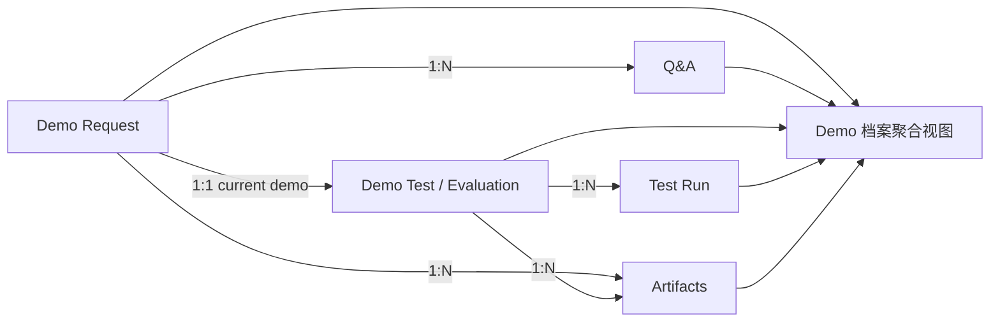

# Demo 档案、Demo Request 与 Demo Test 同步设计

**日期：** 2026-07-22  
**状态：** 已确认交互方向，等待用户审阅书面规格  
**实施范围：** 仅修改当前 Vue / Mock Demo；不接入或修改 Frappe 后端

## 1. 目标

把“Demo 与验证”整理为三个职责清晰、共享同一份 Demo 数据的模块：

1. `Demo 档案`：面向 Boss 查看完整 Demo 全流程，也向其他参与者展示其职责范围内的业务信息、Q&A 和 Demo Test 进度。
2. `Demo Request`：Sales 按标准 Word 表单填写和提交申请；生成、保存并下载 Word 文档。
3. `Demo Test`：FAE 与设备工程师完成准备、Test Run、结果分析和客户外部报告。

本轮还必须完成：

- `Scope Review` 的用户可见名称改为 `FAE Review`。
- Demo 档案左侧列表不显示概率百分比和进度条。
- 经理审核只由 Boss（Mock 角色 `Management Viewer`）操作，Sales Manager 不再具备该权限。
- FAE 与设备工程师采用相同权限和相同分配范围规则。
- Demo Request 新增客户预期时间，显示在 Request ID 附近，但不写入 Demo Request Word。
- Sales 提交的客户问题变成可回答、可追溯的 Q&A，并同步到相关工程师的 Demo 档案。
- Demo Test 的 Test Run DDL 在准备阶段设置。
- Demo Test 报告由系统根据可追溯数据自动生成 PDF，不采用人工上传报告。
- PDF 水印只保留后端接入 Hook，本轮不绘制真实水印。
- Mock 数据和生成文件使用 IndexedDB 保存，刷新和切换身份后仍共享同一份记录。
- CRM Administrator 明确标注“仅供 Demo 演示参考，生产上线后不存在”。

## 2. 不做的内容

- 不接入 Frappe API、DocType、Workflow、File 或生产权限。
- 不把前端字段隐藏、IndexedDB 或身份切换器描述为生产级安全机制。
- 不实现真实 PDF 水印、签名、防复制或防篡改。
- 不新增通用文档中心、通用工作流引擎或无关页面重构。
- 不上传人工编制的 Demo Test Report；外部报告只从当前 Demo 数据自动生成。
- 不把客户预期时间写入原始 Demo Request Word 模板。

## 3. 采用方案

采用“单一共享 Demo Repository + 三个业务视图”。

- Demo Request、Q&A、Demo Test、Test Run、审批和文件都写入同一套关联记录。
- 三个页面通过现有 API Adapter 接口访问同一个 Mock Repository，不再分别读取 `operations-data.ts` 和 Mock Adapter 中互不相干的副本。
- Repository 使用 IndexedDB 持久化结构化记录和文件 Blob；首次使用时写入种子数据，之后刷新不重置。
- Demo 档案由 Demo Request 与 Evaluation/Test Run 聚合得到，不维护第三份需要人工同步的数据副本。

没有采用的方案：

- 页面之间复制数据：实现快，但容易出现 Request、档案和 Test 状态不一致。
- 事件覆盖层：适合复杂审计系统，但当前 Demo 版本成本过高。
- 本地 HTTP 后端：能更接近生产，但超出“只修改 Demo 版本”的范围。

生产接入时，Repository 接口继续保留，由 Frappe Adapter 替换 IndexedDB 实现；权限、字段投影、文件和工作流最终由后端负责。

## 4. 模块与界面

| 模块 | 路由 | 主要用户 | 主要职责 |
| --- | --- | --- | --- |
| Demo 档案 | `/demo-workflow` | Boss、Sales、FAE、设备工程师 | 聚合查看流程、Request、Q&A、Test、文件和结论 |
| Demo Request | `/demo-requests` | Sales、工程师、Boss | 填写、提交、FAE Review、Boss Approval、Word 下载 |
| Demo Test | `/evaluations` | FAE、设备工程师、Sales、Boss | 准备 DDL、Test Run、分析、外部 PDF、客户评审 |

### 4.1 Demo 档案

页面标题从 `Demo` 改为 `Demo 档案`。左侧档案卡保留：Demo/Request ID、状态、客户、标题、Owner、客户预期时间；不显示概率百分比或进度条。

选中档案后按以下顺序展示：

1. 业务概览：客户、商机、设备、Owner、客户预期时间、当前阶段。
2. 流程轨道：Sales Submit → FAE Review → Boss Approval → Preparation → Testing → Analysis → Customer Review。
3. Demo Request 摘要和 Word 文件。
4. Customer Q&A：问题、状态、答案、回答人和回答时间；被分配的工程师可以直接进入 Answer 操作。
5. Demo Test 摘要：Test Run DDL、工程师、Run 数量、最近结果和阶段。
6. Test Run 表格：Run 编号、测试时间、Wafer Lot、Wafer 数量、缺陷捕获率、误报率、WPH、结果摘要。
7. 文件：Demo Request Word 和已发布的 External Demo Test Report PDF。
8. Demo 结论和审批记录。

Demo 档案只聚合来源记录，不提供另一套独立编辑表单。编辑入口仍属于 Demo Request、Q&A Answer 和 Demo Test。

### 4.2 Demo Request

保留已经根据标准 Word 模板实现的完整表单和灰色 placeholder 引导。

Open Questions 中现有 `Questions for Customer` 在本 Demo 业务中明确解释为“客户向公司内部提出、等待内部回答的问题”。Sales 录入问题，工程师只在系统 Q&A 中填写答案；答案不回写原始 Demo Request Word，避免改变已经确认的 Word 模板结构。

新增 `客户预期时间`：

- Sales 保存或提交 Request 时填写，使用日期输入。
- 在列表卡片与详情的 `DR-xxx` 附近显示，例如 `DR-001 · 客户预期 2026-08-15`。
- 同步显示在 Demo 档案业务概览。
- 不写入 Demo Request Word，Word 映射和模板结构保持不变。

Boss 只看正式提交的 Request；`Draft` 对 Boss 完全不可见。Sales 可以查看和编辑自己范围内的 Draft。

用户可见流程名称为：

`Draft → FAE Review → Boss Approval → Demo Test`

内部可继续映射现有状态值以减少无关改动，但界面中不再出现 `Scope Review` 或由 Sales Manager 审批的含义。

### 4.3 Demo Test

沿用现有 Evaluation 路由和状态数据，界面按五组表达：

1. `Preparation`：覆盖 Requested、Scope Confirmed、Sample Received；在此设置 Test Run DDL。
2. `Test Execution`：覆盖 Scheduled、Testing；添加和完成 Test Run。
3. `Analysis`：整理结果摘要并检查指标完整性。
4. `Customer Review`：开放外部 PDF 预览和下载。
5. `Closed`：Accepted 或 Rejected，保留已发布报告记录。

本轮不必重写所有内部枚举；优先通过显示分组和明确的状态转换规则完成重构。

## 5. 权限与可见范围

### 5.1 权限矩阵

| 操作 | Boss / Management Viewer | Sales Manager | Sales User | FAE | 设备工程师 | CRM Administrator |
| --- | --- | --- | --- | --- | --- | --- |
| 查看已提交的跨团队 Demo | 是 | 团队范围 | 自己范围 | 分配范围 | 分配范围 | 是，仅 Demo |
| 查看 Draft Request | 否 | 团队范围 | 自己范围 | 否 | 否 | 是，仅 Demo |
| 创建/编辑 Request | 否 | 是 | 是 | 否 | 否 | 是，仅 Demo |
| FAE Review | 否 | 否 | 否 | 是 | 是 | 是，仅 Demo |
| 回答分配的 Customer Q&A | 否 | 否 | 否 | 是 | 是 | 是，仅 Demo |
| Boss Approval | 是 | 否 | 否 | 否 | 否 | 是，仅 Demo |
| 设置 DDL、写 Test Run | 否 | 否 | 否 | 是 | 是 | 是，仅 Demo |
| 选择外部报告可选内容 | 只读/终审 | 是 | 是 | 提供数据 | 提供数据 | 是，仅 Demo |
| 发布外部报告 | 是 | 否 | 否 | 否 | 否 | 是，仅 Demo |
| 下载已发布外部报告 | 是 | 是 | 是 | 是 | 是 | 是，仅 Demo |

`FAE` 与 `设备工程师` 的 capability 集合和 assigned-scope 过滤规则必须一致，差异只保留角色名称和演示身份。

### 5.2 Demo 档案字段分权

- Boss：查看已提交 Demo 的完整 Request、Q&A、Test、文件、结论和审批信息，并执行审批/发布操作。
- Sales：查看自己或团队范围内的业务信息、Request、Customer Q&A、客户评审报告；不展示工程内部备注和未发布原始分析。
- FAE/设备工程师：查看分配给自己的业务摘要、技术 Request、待回答 Q&A、DDL、Test Run 和工程结果；不展示无关客户、商业敏感信息和其他团队 Demo。
- CRM Administrator：可查看和操作完整演示数据，但界面固定显示“CRM Administrator 仅供 Demo 演示参考，生产上线后不存在”。

前端必须在 Repository/API 返回阶段按身份过滤记录和字段，而不只是使用 `v-if` 隐藏 DOM。即使如此，本轮仍只是演示隔离，生产环境必须由 Frappe 后端再次执行同样的记录权限和字段投影。

## 6. Q&A 设计

Sales 在 Demo Request 的 Open Questions 中录入“客户向公司内部提出的问题”。保存后每条问题转为结构化记录：

```ts
interface DemoQuestion {
  id: string
  demoRequestId: string
  source: 'Customer' | 'Internal'
  question: string
  assignedRole: 'FAE' | 'Equipment Engineer' | 'Both'
  status: 'Open' | 'Answered'
  answer: string
  answeredBy?: string
  answeredAt?: string
}
```

交互规则：

- Sales 提交 Request 后，Customer Questions 同步到该 Demo 档案的 Q&A 区域。
- 只有被分配范围内的 FAE 或设备工程师看到 `Answer` 按钮。
- Answer 弹窗要求填写非空答案；保存时自动记录回答人和时间。
- 回答后 Demo Request、Demo 档案和报告预览立即显示同一结果。
- Internal Questions 供内部协作，不进入外部 PDF。
- 所有 Customer Questions 必须处于 `Answered`，外部 PDF 才满足发布条件。
- 如果 Request 没有 Customer Question，Q&A 门槛视为已满足，外部 PDF 可省略 Q&A 区块。

## 7. 数据模型与关联

在现有 DTO 上做最小扩展：

```ts
interface DemoRequestDto {
  customerExpectedDate: string
  questions: DemoQuestion[]
  // existing fields remain
}

interface EvaluationDto {
  testRunDeadline: string
  reportStatus: 'Not Ready' | 'Ready' | 'Released'
  reportArtifactId?: string
  // existing fields remain
}

interface DemoArtifact {
  id: string
  demoRequestId: string
  evaluationId?: string
  type: 'Demo Request DOCX' | 'External Demo Test Report PDF'
  fileName: string
  mimeType: string
  blob: Blob
  version: number
  createdBy: string
  createdAt: string
  visibility: 'Internal' | 'Customer Review'
}
```

主关联关系：



Demo 档案不保存复制字段；列表和详情每次从上述关联记录聚合，避免同步漂移。

## 8. 跨模块数据流

1. Sales 保存 Draft：写入 IndexedDB；Sales 自己可见，Boss 不可见。
2. Sales 正式提交：Request 进入 FAE Review；Boss 和被分配工程师开始看到档案。
3. 工程师执行 FAE Review，并通过 Answer 按钮回答 Customer Q&A。
4. Boss 执行 Approval；批准后创建或关联 Demo Test。
5. FAE/设备工程师在 Preparation 设置 Test Run DDL，档案与 Sales 视图同步显示。
6. 工程师添加 Test Run；Run 数据只存一处，Demo Test、档案和报告均读取同一记录。
7. 当全部 Customer Q&A 已回答且至少存在一条 Completed Test Run 时，报告状态变为 Ready。
8. 进入 Customer Review 后，Sales 选择允许外发的可选内容并预览 PDF；Boss 终审并发布。
9. 发布后的 PDF Blob 与元数据保存到 Artifacts；Demo Test、Demo 档案和 Sales 视图下载同一版本。

切换 Demo 身份或刷新页面后，所有身份仍从同一个 IndexedDB Repository 读取数据，演示跨角色协作不会恢复为初始种子状态。

## 9. External Demo Test Report PDF

### 9.1 自动生成

PDF 从以下可追溯来源自动生成：

| 报告内容 | 数据来源 |
| --- | --- |
| 客户、设备、Request/Evaluation 关联 | Demo Request / Evaluation |
| 客户预期时间 | Demo Request `customerExpectedDate` |
| Test Run DDL | Evaluation `testRunDeadline` |
| 测试时间、Run 编号、Wafer Lot、Wafer 数量 | Completed Test Run |
| 缺陷捕获率、误报率、Throughput WPH、结果摘要 | Completed Test Run |
| Customer Q&A | Demo Request 关联的已回答 Customer Questions |
| 报告结论 | Test Run 摘要和 Demo Test 分析结果 |

报告沿用已确认样稿方向：左上角保留公司 Logo，其余内容改为客户外部技术摘要。参考样稿为：

`output/pdf/demo-test-external-report-preview.pdf`

### 9.2 外发字段裁剪

内部完整数据与外部 PDF 投影分离。删除外发报告中的敏感或无用内容，只影响该报告版本，不删除 Demo Request、Q&A 或 Test Run 原始记录。

采用显式白名单：只有被列入 External Report Projection 的字段才能进入 PDF。以下内部信息默认永不外发：

- 客户私人联系方式。
- 竞争对手、赢单策略、内部成功因素和商业备注。
- 内部问题、内部讨论和未发布分析。
- 原始文件路径、浏览器存储键和系统错误信息。
- 工程师内部操作日志；Q&A 对外只展示问题和答案，回答人/回答时间默认不展示。

Customer Review 阶段提供“外部报告内容”预览。Sales 可隐藏被标为可选的区块或行，并填写简短的删除原因；Boss 在发布时看到最终预览。核心标识、最终结论和保留的测试行必须形成可理解的报告，不能生成空白 PDF。

### 9.3 生成与下载门槛

必须同时满足：

- 所有 Customer Q&A 已回答。
- 至少存在一条状态为 `Completed` 的 Test Run。
- 每条纳入报告的 Test Run 均有测试时间、Run ID、Wafer Lot、Wafer 数量、捕获率、误报率、WPH 和结果摘要。
- 当前阶段为 `Customer Review`，或已经发布并进入 `Accepted`。

门槛未满足时按钮显示具体缺项，不生成不完整文件。生成失败不改变 Evaluation 状态，也不覆盖上一个已发布版本。

### 9.4 水印 Hook

本轮定义并调用统一接口，但保持透传：

```ts
interface ReportWatermarkContext {
  reportId: string
  customerName: string
  generatedBy: string
  generatedAt: string
}

async function applyDemoTestReportWatermark(
  pdfBytes: Uint8Array,
  context: ReportWatermarkContext,
): Promise<Uint8Array> {
  void context
  return pdfBytes
}
```

PDF 生成流程必须经过该 Hook，便于后续将实现替换为后端水印服务。本轮 Hook 不绘制文字或图片，也不宣称具备安全效果。生产接入时应由后端在文件发布前加水印，前端不负责最终可信水印。

## 10. 文件同步与版本

- Demo Request Word 保存或重新生成后，以 Artifact 形式供 Demo Request 和 Demo 档案下载。
- External PDF 每次 Boss 发布生成一个递增版本；跨模块下载指向同一 Artifact。
- 未发布预览只存在生成流程中，不作为客户可下载文件。
- 新版本发布后保留旧版本元数据，界面默认下载最新 Released 版本。
- Blob 写入失败时不得仅保存一个失效链接；结构化记录保持不变并提示重试。

IndexedDB 只服务当前 Demo。后端接入时文件必须迁移到 Frappe File，并由后端返回有权限的下载地址。

## 11. 错误处理

- IndexedDB 初始化或写入失败：显示“演示数据无法持久化”，不静默回退成看似成功的内存写入。
- Draft 提交校验失败：保留用户输入并定位缺失字段。
- 未分配工程师尝试回答问题：Repository 拒绝写入并返回权限错误。
- 非 Boss 尝试审批或发布：Repository 拒绝写入，即使手动触发前端事件也不能成功。
- Test Run DDL 必须填写且不能早于设置当天，否则阻止离开 Preparation。
- Test Run DDL 晚于客户预期时间时允许保存，但显示明确的延期风险提示并同步给 Sales，供 Sales 与客户沟通。
- PDF 门槛未满足：列出未回答问题或缺失 Test Run 字段。
- PDF/Word 生成失败：不清空记录、不创建空 Artifact、不覆盖上一个已发布文件。
- 数据迁移失败：保留原始 IndexedDB 数据版本并显示可恢复错误，避免自动清空用户演示记录。

## 12. 测试策略

### 12.1 Repository 与持久化

- 首次启动写入种子数据；刷新后读取用户修改的数据。
- 切换 Sales、FAE、设备工程师和 Boss 身份时读取同一关联记录。
- Request、Q&A、Evaluation、Run 和 Artifact 关联正确，无重复档案副本。

### 12.2 权限

- Boss 看不到 Draft，但能看到正式提交的跨团队 Request。
- 只有 Boss 能执行 manager approval 和报告发布。
- Sales Manager 不再拥有 manager approval。
- FAE 与设备工程师拥有完全一致的工程能力和 assigned-scope 行为。
- 非 Boss 只得到允许字段；不能从页面 DOM 或 Repository 返回对象读取被裁剪字段。
- CRM Administrator 始终显示 Demo-only 提示。

### 12.3 Q&A 与 Demo Test

- Sales 提交的 Customer Questions 在相关工程师档案中出现。
- Answer 保存后三个模块显示同一答案、回答人和时间。
- DDL 只能在 Preparation 编辑，并同步到 Demo 档案和 Sales 可见进度。
- Completed Run 自动参与报告；Planned Run 不满足报告门槛。

### 12.4 文档

- 客户预期时间不出现在 Demo Request Word。
- Word 与 PDF Artifact 在相关模块下载的是同一个持久化版本。
- PDF 包含所有被选中的必需 Test Run 字段和已回答 Customer Q&A。
- 默认外发白名单不会泄露内部敏感字段。
- 取消可选字段后 PDF 不包含该内容，但源数据仍完整。
- 水印 Hook 被调用且当前返回未加水印的有效 PDF。
- PDF 渲染为两页时公司 Logo、表格、分页和页脚无重叠或裁切。

### 12.5 回归命令

```powershell
pnpm.cmd test
pnpm.cmd typecheck
pnpm.cmd build
```

## 13. 验收标准

- 侧栏依次显示 `Demo 档案`、`Demo Request`、`Demo Test`。
- Demo 档案聚合显示 Request、Q&A、Test Run、DDL、文件和结论；左侧无概率百分比。
- 页面不再显示 `Scope Review`，统一显示 `FAE Review`。
- 客户预期时间显示在 DR 编号附近、同步到档案，但不进入 Request Word。
- Sales 提交后 Boss 才能看见 Request；Draft 对 Boss 隐藏。
- 只有 Boss 可以审批，Sales Manager 不可审批。
- FAE 和设备工程师权限一致，能够回答分配的 Q&A、设置 DDL、记录 Test Run。
- Q&A 和 Test Run 修改会同步反映在三个模块，刷新后仍存在。
- 满足门槛后在 Customer Review 开放 PDF；报告来源可追溯、允许裁剪外发可选内容、源数据不被删除。
- 发布后的 PDF 在 Demo Test、Demo 档案和 Sales 视图中为同一文件版本。
- 水印 Hook 存在并被调用，但本轮 PDF 无真实水印。
- CRM Administrator 明确标记为 Demo-only 身份。
- 全量测试、类型检查和构建通过。
