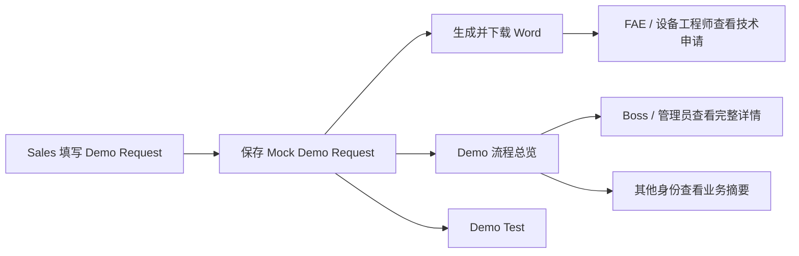

# Demo 与验证三模块及 Word Request 设计

**日期：** 2026-07-22
**状态：** 已确认设计，等待实施计划
**范围：** 仅修改当前 Vue / Mock Demo；不修改 Frappe 后端、DocType、后端状态机或生产权限

## 1. 目标

把侧栏中的“Demo 与验证”拆分为三个清晰入口：

1. `Demo`：提供面向 Boss 的完整 Demo 流程总览，并为其他身份隐藏敏感详情。
2. `Demo Request`：由 Sales 按标准 Word 模板填写申请，保存后可生成并下载填写完成的 `.docx` 文件，供 Sales、FAE 和设备工程师查看。
3. `Demo Test`：作为工程师依据 Demo Request 开展测试分析的入口；本轮只完成入口、命名和定位说明，不增加新的测试操作。

同时完成两项界面调整：

- Mock Demo 中用户可见的 `Scope Review` 改为 `FAE Review`。
- `Demo` 页面左侧申请卡片隐藏进展百分比和进度条。

## 2. 明确不做的内容

- 不修改 `backend/` 下的 Frappe API、DocType、Workflow 和权限规则。
- 不把本轮前端身份展示称为生产级安全隔离。
- 不为 `Demo Test` 新增测试分析字段、状态或写操作。
- 不引入与 Word 模板填写无关的新功能或通用文档平台。
- 不重构无关页面、导航组或设计系统。

## 3. 采用方案

复用已有页面与路由，只拆分导航并在现有组件上做小范围扩展：

| 模块 | 路由 | 复用页面 | 本轮职责 |
| --- | --- | --- | --- |
| Demo | `/demo-workflow` | `DemoWorkflowPage.vue` | 流程总览、角色视图、隐藏进展百分比、FAE Review 文案 |
| Demo Request | `/demo-requests` | `DemoRequestsPage.vue` | 完整模板表单、Mock 保存、Word 下载 |
| Demo Test | `/evaluations` | `EvaluationsPage.vue` | 增加独立导航入口并改名，不新增操作 |

不采用单页三标签方案，因为三个业务职责需要在侧栏中清晰可见；不重新建立三套数据模型，因为当前已有页面和 Mock 数据已经覆盖基本边界。

## 4. 业务流程



## 5. 导航设计

“Demo 与验证”组按以下顺序显示三个入口：

1. `Demo`
   - 路径：`/demo-workflow`
   - 能力：具有 `demo_request:view` 或 `evaluation:view` 即可进入。
2. `Demo Request`
   - 路径：`/demo-requests`
   - 能力：具有 `demo_request:view` 即可进入。
3. `Demo Test`
   - 路径：`/evaluations`
   - 能力：具有 `evaluation:view` 即可进入。

不改变其他导航组、入口顺序和路由行为。

## 6. Demo 总览权限设计

方案 A 仅约束 `Demo` 总览页面。`Demo Request` 和 Word 下载继续按工作职责展示完整技术申请。

### 6.1 完整视图

以下 Mock 身份看到现有完整内容：

- `Management Viewer`：代表 Boss。
- `CRM Administrator`：保留系统演示与排错所需的完整视图。

完整视图包含业务摘要、流程、联系方式、成功因素、执行、晶圆、Test Run、问题和结论。

### 6.2 业务摘要视图

以下身份只在 `Demo` 总览中看到业务摘要：

- `Sales Manager`
- `Sales User`
- `FAE / Applied Engineer`
- `Equipment Engineer`

业务摘要保留：

- Demo ID、标题、状态
- 客户、商机
- Demo Owner、Primary Tool
- 目标日期、概括性 Objective
- Approval / Customer Review 流程节点
- Demo Execution 的编号、负责人、设备、窗口和状态

业务摘要隐藏：

- Customer Contact 和 Sales Contact 详情
- Other Tools / 竞品及 Complementary Tool 细节
- Success Factors
- Wafer Samples 明细
- Test Runs & Result 明细
- Internal Questions
- Customer Questions
- Demo Conclusion、客户反馈、Prepared / Approved 详情

### 6.3 Demo 级权限限制说明

本轮只在前端渲染前根据当前 Mock 身份选择完整视图或业务摘要视图。敏感数据仍存在于浏览器内存的 Mock 对象中，因此这只是 Boss 演示用的界面分权，不是生产环境的数据安全边界。真实部署必须由 Frappe 后端进行字段投影和权限校验。

## 7. Demo 总览界面调整

- 页面标题由 `Demo Request` 调整为 `Demo`，避免与申请填写模块混淆。
- 左侧申请卡片保留状态、标题、客户、商机、负责人和目标日期。
- 删除左侧卡片的 `xx%` 文本和进度条，不删除 Mock 数据中的 `progress` 字段，避免影响其他页面。
- Mock 用户界面中的流程标签 `Scope Review` 改为 `FAE Review`。
- 内部枚举和真实 Frappe 状态不在本轮修改；只修改 Mock 数据和用户可见文案。

## 8. Demo Request 表单设计

表单采用单页分区布局，不使用多步骤向导。桌面端可使用双列字段，长文本、问题和晶圆表格使用整行；窄屏自动改为单列。

Word 模板声明“除标记为 optional 外均为必填”。因此 `Complementary Tool` 为唯一可选业务字段；自动生成的签署字段不要求 Sales 手工填写。

### 8.1 主表单字段与灰度提示

灰度提示通过 `placeholder` 或等效占位内容呈现，颜色使用设计系统的弱化文字色。提示不是字段值，不进入 Mock 数据，也不写入下载文档。

| 区域 | 字段 | 灰度提示 | 规则 |
| --- | --- | --- | --- |
| Customer Information | Company Name | `请输入客户公司全称` | 必填；默认关联当前 CRM 客户 |
| Customer Information | Contact Person | `Name, title, email, phone` | 必填 |
| Customer Information | Industry | `e.g. Frontend Fab, Power devices, MEMS, Photonics, Advanced Packaging etc.` | 必填 |
| Owner Information | Sales Contact | `Sales dept contact for this demo` | 必填；默认当前 Sales |
| Owner Information | Demo Owner | `R&D or Applications engineer responsible` | 必填 |
| Sample Information | Number of Wafers | `根据下方 Wafer Details 自动计算` | 只读，由有效晶圆行数计算 |
| Sample Information | Size & Shape | `Diameter, thickness, warpage, notch or flat(s), shape...` | 必填 |
| Sample Information | Material (Substrate) | `Including crystal orientation, e.g. Si(100), GaN-on-Si, SiC 4H, etc.` | 必填 |
| Sample Information | Specific Request | `Surface contact handling, edge exclusion, backside constraints...` | 必填 |
| Demo Purpose | What to Detect / Measure | `Defect type, typical size, density, location on wafer...` | 必填 |
| Demo Purpose | Expected Results | `Pictures, dimensions, tool performance, report files...` | 必填 |
| Demo Purpose | Other Tools | `Competitors, tool of record, other solutions currently used` | 必填 |
| Our Proposal | Primary Tool | `Tool selected based on discussion with customer` | 必填 |
| Our Proposal | Complementary Tool | `To demonstrate additional capabilities or for internal learning` | 可选 |
| Our Proposal | Timing | `Proposed schedule taking into account customer expectations` | 必填 |
| What Will Make Us Winning | Key Success Factors | `What should we focus on to make sure we address the right objective?` | 必填 |
| Open Questions | Internal Questions | `请输入需要内部确认的问题` | 必填 |
| Open Questions | Questions for Customer | `请输入需要客户确认的问题` | 必填 |

### 8.2 签署字段

| Word 字段 | 来源 |
| --- | --- |
| Prepared by | 保存时的当前 Demo 身份 |
| Prepared Date | 保存日期 |
| Approved by | Mock 经理批准时的身份；未批准保持空白 |
| Approved Date | Mock 批准日期；未批准保持空白 |

### 8.3 Wafer Details

Sales 可新增或删除晶圆行。至少保留一行；任一单元格有内容的晶圆行都计入 `Number of Wafers`，并且必须在保存或下载前补全该行的六个字段。完全空白的附加行不计数。

| 字段 | 灰度提示 | 规则 |
| --- | --- | --- |
| Slot ID | `Cassette slot number (1-25)` | 必填 |
| WID | `Wafer identification number or lot ID` | 必填 |
| Wafer Specificity | `Material, crystal orientation, layer stack, coatings, thickness, diameter...` | 必填 |
| Notch / Flat | `Notch or flat orientation and type` | 必填 |
| DOI / Metrology Items | `Defect type, size, density, location, layers to measure...` | 必填 |
| Result File Provided | `Wafer map, images, CSV, KLARF, report PDF...` | 必填 |

如果填写超过模板现有的 25 行，导出时复制最后一行的表格格式继续追加，不截断数据。

## 9. Mock 数据设计

现有 `DemoRequestDto` 需要扩展模板字段和晶圆明细数组。已有字段继续保留并映射到新字段，避免破坏现有卡片和审批演示：

- `title`：继续作为卡片标题，但不是 Sales 的额外输入项；保存时按 `<Company Name> · <Primary Tool> Demo` 自动生成。
- `objective`：映射到 `What to Detect / Measure` 的概括内容，用于现有摘要。
- `requestedEquipment`：映射到 `Primary Tool`。
- `sampleQuantity`：由 Wafer Details 有效行数计算。
- `acceptanceCriteria`：映射到 `Key Success Factors` 的概括内容。

新增和修改仅保存在当前 Mock 适配器会话中。浏览器完全刷新后恢复初始演示数据，这是本轮接受的 Demo 行为。

## 10. Word 生成与下载

### 10.1 模板

使用用户提供的 `250709-Demo_Request_Form V2.docx` 作为固定模板来源。项目中保存一份仅供当前 Demo 使用的模板资产，不修改用户原文件。

### 10.2 生成规则

- 客户端读取模板并将表单值写入对应表格单元格。
- 保持原模板的章节、表格、页眉、页脚、Logo 和 Annex 布局。
- 晶圆明细按填写顺序写入 Annex。
- 空的 Optional 字段写为空白，不写入提示词。
- 所有用户文本在写入 OOXML 前进行 XML 转义。
- 下载 MIME 类型为 `application/vnd.openxmlformats-officedocument.wordprocessingml.document`。
- 文件名格式为 `Demo_Request_<RequestID>_<Company>_<YYYY-MM-DD>.docx`；文件名中的非法字符替换为短横线。

### 10.3 下载入口

- 每张 Demo Request 卡片显示“下载 Word”。
- Sales、FAE 和设备工程师都可使用下载入口。
- 下载前执行与保存相同的完整校验。
- 已保存申请使用该申请当前数据生成文档，不使用表单中的未保存内容。

## 11. Demo Test 设计

- 在侧栏增加 `Demo Test`，路由保持 `/evaluations`。
- 页面标题调整为 `Demo Test`。
- 页面说明明确：“工程师依据 Demo Request 进行测试与分析”。
- 保留现有 Evaluation / Test Run 演示能力，不新增、不删除、不重构现有操作。

## 12. 校验与错误处理

### 12.1 表单校验

- 缺少任一必填字段时，阻止保存和下载。
- 失败字段显示错误边框及字段下方的简短错误信息。
- Complementary Tool 为空不报错。
- Wafer Details 少于一条有效记录时阻止保存和下载。
- 任一有效晶圆行缺少六个必填字段中的任何一个时阻止保存和下载。

### 12.2 文档错误

- 模板加载失败：显示“Word 模板加载失败，请重试”，不触发空下载。
- 文档生成失败：显示“Word 文档生成失败，请检查申请内容后重试”。
- 下载失败不清空当前表单或已保存数据。

## 13. 测试与验收标准

### 13.1 导航与页面

- “Demo 与验证”下按顺序显示 `Demo`、`Demo Request`、`Demo Test`。
- 三个入口分别进入 `/demo-workflow`、`/demo-requests`、`/evaluations`。
- `Demo Test` 页面标题和定位说明正确，现有操作保持不变。

### 13.2 Demo 总览

- Management Viewer 和 CRM Administrator 可以看到完整详情。
- Sales Manager、Sales User、FAE 和 Equipment Engineer 看不到第 6.2 节列出的敏感区块。
- 业务摘要视图仍可看到客户、商机、状态、设备、Owner、目标日期和流程节点。
- 左侧申请卡片不存在百分比文本和进度条。
- Mock Demo 的可见流程文案显示 `FAE Review`，不再显示 `Scope Review`。

### 13.3 Demo Request

- 表单包含第 8 节全部字段和原模板提示。
- 灰度提示在输入后消失，且不作为数据保存。
- Complementary Tool 可空，其余业务字段必填。
- Wafer 行可新增、删除，Number of Wafers 自动更新。
- 保存后卡片显示最新的申请摘要。

### 13.4 Word 下载

- 下载文件是可打开的 `.docx`。
- 主表单值、签署值和 Wafer Details 出现在正确单元格。
- 原模板页眉、页脚、Logo、章节和 Annex 仍存在。
- 灰度提示没有作为用户数据写入。
- 多条晶圆逐行写入，超过 25 行时不丢失。
- 缺少必填字段或模板加载失败时不会产生空文件。

### 13.5 回归验证

实施完成后执行：

```powershell
pnpm.cmd test
pnpm.cmd typecheck
pnpm.cmd build
```

所有命令必须成功；若出现与本次改动无关的既有失败，应记录原始错误并单独说明，不扩大修改范围。
