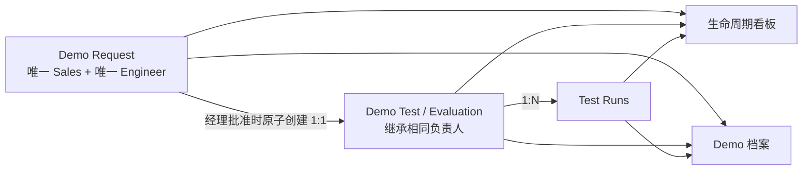

# Demo 数据重建、唯一负责人权限与 Request/Test 界面同步设计

**日期：** 2026-07-28  
**状态：** 用户已确认设计方向  
**范围：** 当前 Vue / Mock Demo 的 Demo Request、Demo Test、生命周期看板与 Demo 档案  
**不包含：** Frappe 后端、移动端适配、Git 合并或提交

## 1. 目标

本轮修改解决以下问题：

1. 删除当前全部 Demo 案例，重新建立 10 个可追溯、互相关联的新 Demo。
2. 每个 Demo 始终拥有且只拥有一个 Sales Owner 和一个 Engineer Owner。
3. 工程负责人只能是系统真实身份演示员工14或演示员工15，修复 Engineer Review 有项目、个人工作区却为空的问题。
4. Demo Request 经经理批准后原子创建唯一 Demo Test，Request、Test、生命周期看板和归档读取同一份关联数据。
5. Demo Test 的页面风格和内容组织与 Demo Request 对齐，同时保留测试阶段自己的操作与字段。
6. 所有负责人字段使用必填下拉选择，不允许自由输入无效姓名。

系统 Q&A 和 On Hold 继续保持删除状态，不在本轮恢复。

## 2. 采用方案

采用“仅重置 Demo 域 + 单一 Repository 投影”的方案：

- Snapshot 从 v5 升级为 v6。
- v6 首次加载时，用新的 10 个 Demo 替换旧 `demoRequests`、`evaluations` 和 Demo `artifacts`。
- 客户、联系人、设备、商机、活动等非 Demo 数据不受影响。
- 生命周期看板与 Demo 档案只从新 Request、Evaluation、Run 和 Artifact 聚合，不再追加 `operations-data.ts` 中的旧 `demoProjects`。
- 后续用户对 v6 数据的修改继续保存在 IndexedDB，普通刷新不会重复重置。

未采用的方案：

- 迁移并重新分配旧 Demo：不符合“删除当前全部案例”。
- 只修改前端姓名映射：旧数据、错误负责人和跨模块状态漂移仍然存在。
- 引入新后端或状态引擎：超出当前 Vue / Mock Demo 范围。

## 3. 数据关系和状态来源



### 3.1 Request 与 Test 边界

- `Engineer Review`、`Manager Approval`：只有 Demo Request，不提前创建 Evaluation。
- 经理批准：在同一次 Repository 写入中把 Request 设为 `Converted`、创建唯一 Evaluation，并写入双向关联。
- `Test Preparation`、`Test Execution`、`Customer Review`：Request 为 `Converted`，存在且只存在一个关联 Evaluation。
- `Accepted`、`Rejected`：Request 与 Evaluation 继续保留，Evaluation 进入 Demo 档案。
- 生命周期阶段由 Request/Evaluation 当前状态计算，不保存第三份独立阶段数据。

### 3.2 负责人继承

- `request.salesOwner` 是唯一 Sales Owner。
- `request.engineerOwner` 是唯一 Engineer Owner。
- `evaluation.owner` 必须始终等于 `request.engineerOwner`。
- Request 转 Test、Test 转归档时不重新填写负责人。
- Manager Approval 的审批人是流程操作者，不取代 Sales Owner 或 Engineer Owner。
- 负责人变更必须写入 Request history；不允许产生空值、团队占位符或未知姓名。

## 4. 新的 10 个 Demo

新编号使用 `DR-101` 至 `DR-110`，避免与被删除的旧案例混淆。Test 编号使用 `EVAL-101` 至 `EVAL-106`。

| Request | 生命周期位置 | Evaluation | Engineer Owner | Sales Owner |
| --- | --- | --- | --- | --- |
| DR-101 | Engineer Review | 无 | 演示员工14 | Demo Staff 01 |
| DR-102 | Engineer Review | 无 | 演示员工15 | Demo Staff 02 |
| DR-103 | Manager Approval | 无 | 演示员工14 | Demo Staff 02 |
| DR-104 | Manager Approval | 无 | 演示员工15 | Demo Staff 01 |
| DR-105 | Test Preparation | EVAL-101 | 演示员工14 | Demo Staff 01 |
| DR-106 | Test Preparation | EVAL-102 | 演示员工15 | Demo Staff 02 |
| DR-107 | Test Execution | EVAL-103 | 演示员工14 | Demo Staff 02 |
| DR-108 | Customer Review | EVAL-104 | 演示员工15 | Demo Staff 01 |
| DR-109 | 已归档 Accepted | EVAL-105 | 演示员工14 | Demo Staff 01 |
| DR-110 | 已归档 Rejected | EVAL-106 | 演示员工15 | Demo Staff 02 |

分布结果：

- 4 个处于 Demo Request 阶段。
- 4 个处于 Demo Test 阶段。
- 2 个进入 Demo 档案。
- 演示员工14负责 5 个，演示员工15负责 5 个，合计覆盖全部 10 个。
- Demo Staff 01 负责 5 个，Demo Staff 02 负责 5 个。
- 两位工程师在 Engineer Review、后续 Test 和归档中都有可验证记录。

新案例复用现有客户和设备主数据，但标题、流程历史、测试结果和关联信息全部重新生成。归档的两个案例分别覆盖 Accepted 和 Rejected，并可按客户和设备分类。

## 5. 负责人下拉框

### 5.1 可选值

- Sales Owner：`Demo Staff 01`、`Demo Staff 02`
- Engineer Owner：`演示员工14`、`演示员工15`

选项来自统一的 Demo identity/owner 配置，不在表单中重复维护字符串。

### 5.2 交互

- Demo Request 新建和允许编辑负责人时，两个字段均显示为必填下拉框。
- 下拉框使用与现有表单一致的标签、必填标记、边框、聚焦和错误提示样式。
- 不引入新 UI 依赖，不使用自由文本回退。
- Sales User 的 Sales Owner 选项受自身允许范围限制；管理员或管理角色可从完整 Sales Owner 列表选择。
- Engineer Owner 可从演示员工14、演示员工15中选择。
- 普通工程师不能将自己的 Demo 重新分配给另一位工程师；允许重新分配的管理角色通过同一个下拉框操作。
- Demo Test 只显示继承的负责人，不提供第二套独立负责人输入。

### 5.3 写入校验

UI 校验和 Mock API/Repository 校验同时执行：

- 两个 Owner 均不能为空。
- Engineer Owner 必须严格等于演示员工14或演示员工15。
- Sales Owner 必须严格等于允许的 Sales Owner。
- `FAE Leo`、`FAE Mia`、`FAE Team`、`未分配` 和任意自由文本均被拒绝。
- Evaluation Owner 与 Request Engineer Owner 不一致时拒绝保存或在 v6 种子构建阶段直接报错。

## 6. 权限与个人工作区

| 角色/身份 | 可见范围 | 负责人调整 |
| --- | --- | --- |
| 演示员工14，FAE / Applied Engineer | `engineerOwner === 演示员工14` | 不可转派给演示员工15 |
| 演示员工15，Equipment Engineer | `engineerOwner === 演示员工15` | 不可转派给演示员工14 |
| Demo Staff 01，Sales User | 自己作为 Sales Owner 的 Demo | 仅限允许范围 |
| Sales Manager | 团队 Sales Owner 范围 | 按现有 capability |
| Management Viewer | 全部，保持只读/审批边界 | 不因查看权限获得普通编辑权 |
| CRM Administrator | 全部 Demo | 可按现有 Demo capability 调整 |

同一权限过滤规则应用于：

- Demo Request 列表和各阶段工作区。
- Demo Test 列表、详情和操作。
- 生命周期看板。
- Demo 档案和详情。

筛选只在已经通过权限过滤的数据内工作，不能通过选择“全部”或 URL `focus` 绕过权限。演示员工14和演示员工15登录后，在自己的 Engineer Review 和 Demo Test 工作区中必须能看到种子数据。

## 7. Demo Test 与 Demo Request 的界面同步

Demo Test 不再使用与 Request 明显割裂的三列卡片墙，改为复用 Demo Request 的桌面工作区语言：

1. 相同的 `PageHeader` 层级、eyebrow、标题和说明排版。
2. 相同的顶部工作区导航形式。
3. 相同的左侧选择栏：负责人/客户筛选、搜索、记录列表和选中状态。
4. 相同的 Overview 结构：统计摘要、主表格、右侧选中记录预览。
5. 相同的阶段详情结构：顶部摘要条、中央业务内容、右侧操作面板。
6. 相同的颜色、边框、圆角、字号、间距、按钮和空状态。

Demo Test 的工作区导航为：

- `Overview`
- `Test Preparation`
- `Test Execution`
- `Customer Review`

页面共同字段按与 Request 相同的位置和顺序展示：

- 客户 / Demo 标题
- Demo Test ID 与来源 Request ID
- Sales Owner
- Engineer Owner
- 设备
- 当前状态

Test 专属内容保留：

- Preparation 状态与 Test Run DDL 设置操作。
- Test Run 列表、Lot、Wafer 数量、Capture、False Positive、WPH 和结果摘要。
- 测试状态流转。
- Customer Review 的 External Report 状态、预览和发布入口。
- Request 跳转到 Test 时的 `focus` 高亮与来源追溯。

Demo Test 不复制 Request 表单字段，也不引入第二套 Owner 编辑入口。视觉和信息层级同步，不改变 Test 的业务职责。

## 8. 生命周期看板与 Demo 档案

- 生命周期看板继续包含 Engineer Review、Manager Approval、Test Preparation、Test Execution、Customer Review。
- 10 个新 Demo 使用正常卡片尺寸，不因过去预计 30–40 条而强制压缩。
- 卡片只显示客户、Demo ID/简短标题、Sales、Engineer 和健康状态。
- 卡片不显示人物头像、Test Run DDL、客户预期日期或其他日期。
- 红色规则：距客户预期时间不超过 7 个自然日。
- 橙色规则：连续 5 个自然日没有有效进展。
- 其他正常进行状态为绿色。
- 点击卡片进入现有 Demo 详情。
- Demo 档案只包含 Accepted/Rejected，继续支持按客户、设备分类。
- 系统 Q&A 和 On Hold 不出现在列表、详情、筛选或操作中。

## 9. 数据重置和错误处理

### 9.1 v6 重置

- 读取 v1–v5 Snapshot 时，不迁移旧 Demo 记录，直接创建新的 v6 Demo Snapshot。
- 重置目标仅包括 Demo Request、Evaluation、Run 和 Demo Artifact。
- 不从 `demoProjects` 重新补入旧归档。
- 保存成功后再替换当前 Snapshot，避免生成半套 Request/Test 数据。
- 已经是 v6 时直接读取，不因刷新再次覆盖用户操作。

### 9.2 一致性失败

种子或写入出现以下情况时阻止提交：

- Demo 总数不是 10。
- 归档数量不是 2。
- Request 与 Evaluation 关联重复或悬空。
- Test/Archive 阶段没有 Evaluation。
- Request 阶段提前存在 Evaluation。
- Owner 为空或不在合法列表。
- Request Engineer 与 Evaluation Owner 不一致。
- 演示员工14或演示员工15的总分配数不是 5。

界面写入失败时保留用户输入并显示错误，不产生部分创建的 Evaluation。

## 10. 验证策略

### 10.1 Repository 与种子

- v5 Snapshot 打开后变为 v6，旧 Demo ID、旧 Evaluation 和旧 Demo Artifact 均不存在。
- v6 恰好包含 10 个 Request、6 个 Evaluation 和 2 个归档结果。
- Request/Test/Archive 阶段分布与表格一致。
- 演示员工14和演示员工15各 5 个，Demo Staff 01 和 Demo Staff 02 各 5 个。
- 所有关联和 Owner 一致性校验通过。
- 再次读取 v6 不重置用户修改。

### 10.2 权限

- 演示员工14只能读取自己的 5 个 Demo，并能在 Engineer Review 和 Demo Test 中看到对应记录。
- 演示员工15只能读取自己的 5 个 Demo，并能在 Engineer Review 和 Demo Test 中看到对应记录。
- 两位工程师不能通过查询参数查看对方记录。
- Sales、Sales Manager、Management Viewer 和 Administrator 保持各自范围。

### 10.3 表单与同步

- Owner 字段渲染为下拉框，无法输入自由文本。
- 创建 Request 时两个 Owner 必填。
- 经理批准后一次写入完成 Request 转换、Evaluation 创建和双向关联。
- Evaluation Owner 自动继承，不出现第二次选择。
- 重复批准不创建第二个 Evaluation。

### 10.4 页面

- Demo Test 具有与 Demo Request 对齐的导航、左侧选择栏、Overview、详情和操作面板。
- Test 专属操作仍可按状态和权限使用。
- `?focus=EVAL-xxx` 能定位有权限的记录，无权限记录不泄露。
- 生命周期看板显示 8 个进行中 Demo，Demo 档案显示 2 个归档 Demo。
- 卡片无头像、Test Run DDL 和客户预期日期。
- 归档可按客户和设备分类。
- Q&A 与 On Hold 不出现。

### 10.5 回归

优先运行 Demo 领域、Mock Adapter、Request 页面、Evaluation 页面、生命周期和权限测试，再运行：

```powershell
pnpm.cmd typecheck
pnpm.cmd build
```

浏览器在 `http://127.0.0.1:4173` 验证管理员、演示员工14和演示员工15三个身份。当前工作区存在与本任务无关的并行修改时，测试结果需区分本轮聚焦验证和既有失败，不修改无关模块。

## 11. 验收标准

- 当前旧 Demo 全部消失，系统中只有新建的 10 个 Demo。
- 8 个进行中记录分布于 Request 和 Test，2 个记录进入归档。
- 演示员工14和演示员工15各自负责 5 个，并在自己的 Engineer Review/Test 工作区看到正确记录。
- 每个 Demo 均有唯一 Sales Owner 和唯一 Engineer Owner。
- 所有 Owner 使用真实下拉选项，旧 FAE 名称无法再次写入。
- Request 批准后只创建一个同步 Test，四个 Demo 入口读取同一关联数据。
- Demo Test 的视觉结构和内容层级与 Demo Request 一致，Test 操作保持可用。
- 生命周期卡片与归档符合已确认的显示、健康状态和分类规则。
- 系统 Q&A 和 On Hold 保持删除。
- 不修改非 Demo 数据，不进行 Git 合并或提交。
