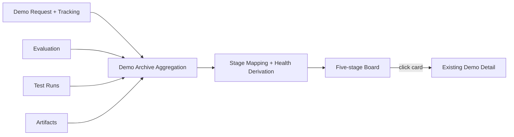

# Demo 生命周期看板与追踪设计

**日期：** 2026-07-28
**状态：** 用户已确认设计与高保真图，进入前端实现
**范围：** 当前 Vue / Mock Demo；不接入或修改 Frappe 后端

## 1. 目标

把 `Demo 档案` 的默认入口改造成面向管理者的生命周期看板，让用户可以在一个页面中看到全部正在进行的 Demo、当前阶段、客户时间风险和停滞风险。

本次设计解决以下问题：

- 用一个五阶段横向看板统一展示正在进行的 Demo。
- 卡片只承担快速扫描和风险识别，不复制现有详情内容。
- 点击卡片进入当前 Demo 档案详情，继续查看 Request、Test Run、Artifact 和结论。
- 使用可解释的红、橙、绿规则展示客户时间风险和推进风险。
- 增加轻量追踪字段，使“连续 5 天没有有效进展”能够被可靠计算。
- 删除系统内的结构化 Q&A 工作流，但保留原始 Demo Request Word 表单中的问题字段。
- 从 Demo 体系中移除 `On Hold` 状态和相关操作。

## 2. 设计原则

- 生命周期阶段与健康度是两个维度。看板列表示阶段，红橙绿表示健康度。
- 看板只读，不通过拖拽或卡片快捷操作改变业务状态。
- Demo Request 和 Demo Test 继续负责真实业务状态推进。
- Demo 档案继续从共享 Demo Repository 动态聚合，不保存第三份业务副本。
- 健康度实时推导，不把颜色永久写入数据，避免日期变化后颜色失真。
- 颜色必须同时配合状态点、图标和原因文字，不能只依赖颜色表达。
- 保持当前 Planck CRM 视觉语言，不复制 Salesforce 品牌样式。

## 3. 页面与路由

### 3.1 默认看板

访问 `/demo-workflow` 时默认展示生命周期看板。

看板只包含权限范围内正在进行的 Demo。以下记录不进入看板：

- `Draft`
- `Cancelled`
- Evaluation 为 `Accepted`
- Evaluation 为 `Rejected`

`Accepted / Rejected` 继续进入现有已完成历史档案。

### 3.2 详情模式

点击任意卡片后进入：

```text
/demo-workflow?view=detail&focus=<Demo ID>
```

详情模式复用当前 Demo 档案详情内容，不新建第二套详情组件。

返回看板后必须保留：

- 搜索条件
- 健康度筛选
- 看板滚动位置

搜索和健康筛选可以写入路由查询参数；滚动位置保留在当前页面会话中。

找不到 `focus` 对应档案时，返回看板并显示明确提示，不展示空白详情。

## 4. 生命周期看板

### 4.1 五阶段

看板横轴固定为：

```text
Engineer Review
→ Manager Approval
→ Test Preparation
→ Test Execution
→ Customer Review
```

阶段映射如下：

| 看板阶段 | 源状态 |
| --- | --- |
| Engineer Review | `Engineer Review`、`Engineer Returned` |
| Manager Approval | `Manager Approval`、`Manager Rejected` |
| Test Preparation | `Requested`、`Scope Confirmed`、`Sample Received`、`Scheduled` |
| Test Execution | `Testing`、`Analysis` |
| Customer Review | `Customer Review` |

Request 为 `Converted` 且已经关联 Evaluation 时，以 Evaluation 状态确定看板阶段。

### 4.2 布局

- 顶部使用连续箭头式五阶段轨道。
- 每个阶段显示当前卡片数量。
- 桌面端五列并排。
- 较窄窗口允许看板横向滚动，不压缩卡片到不可读。
- 某阶段没有 Demo 时仍保留该列，并显示简洁空状态。
- 页面只提供搜索和健康度筛选，不增加收入汇总、图表或 KPI 卡。

### 4.3 卡片字段

每张卡片只展示：

- 健康状态色、状态点和一行原因。
- 客户简称或客户名称。
- Demo ID 与简短标题，标题最多两行。
- 当前 Owner 纯文字，不显示人物头像。

整张卡片可点击。卡片不展示：

- Test Run DDL 和客户预期时间；两者仅参与健康度推导并在详情中查看。
- Demo Request 完整字段。
- Test Run 指标明细。
- Artifact 列表。
- 结论详情。
- Q&A。
- 状态修改菜单。
- 拖拽手柄。

## 5. 健康度规则

### 5.1 计算优先级

```text
红色 > 橙色 > 绿色
```

健康度使用 `Asia/Shanghai` 时区的自然日计算。

### 5.2 红色：客户或测试时间风险

满足任一条件时显示红色：

- 客户预期时间已经逾期。
- 距离客户预期时间不超过 7 个自然日。
- Test Run DDL 已经逾期。

原因文字必须说明触发条件，例如：

```text
距客户预期仅 7 天
客户预期已逾期 2 天
Test Run DDL 已逾期 1 天
```

### 5.3 橙色：停滞风险

没有红色条件，并且连续 5 个自然日没有有效进展时显示橙色。

橙色不再由以下条件触发：

- 下一动作逾期。
- 没有设置下一动作。
- 没有设置负责人。
- 缺少客户预期时间。

原因文字统一表达为：

```text
已连续 5 天无有效进展
```

天数超过 5 天时显示实际停滞天数。

### 5.4 绿色：正常推进

没有红色条件，并且最近 5 个自然日内存在有效进展时显示绿色。

客户预期时间缺失时显示“待确认”，但不会仅因字段缺失改变健康度。

## 6. 有效进展

以下动作会更新 Demo 的最后有效进展：

- Request 提交或重新提交。
- Engineer Review 批准或退回。
- Manager Approval 或 Manager Reject。
- 创建或关联 Evaluation。
- 设置或修改 Test Run DDL。
- Evaluation 合法推进到下一状态。
- 创建计划 Test Run。
- 完成 Test Run 并保存结果。
- 进入 Customer Review。
- 发布客户报告。
- 更新下一动作、负责人或下一动作截止时间。

以下行为不算有效进展：

- 打开或关闭详情。
- 搜索和筛选。
- 切换 Demo 身份。
- 下载已有文件。
- 页面刷新。
- 健康度重新计算。

状态变化和追踪字段更新必须在同一个 Repository 事务中完成。任一写入失败时整个业务动作回滚。

## 7. 轻量追踪模型

追踪对象挂在 Demo Request 主记录上，因为 Request 贯穿整个 Demo 生命周期：

```ts
interface DemoTracking {
  lastProgressAt: string
  lastProgressSummary: string
  lastProgressActor: string
  nextAction: string
  nextActionOwner: string
  nextActionDue: string
}
```

健康度由纯领域函数实时计算：

```ts
deriveDemoHealth({
  lastProgressAt,
  customerExpectedDate,
  testRunDeadline,
  today,
})
```

领域函数返回：

```ts
interface DemoHealth {
  level: 'healthy' | 'stalled' | 'critical'
  reason: string
  daysSinceProgress: number
  daysToCustomerExpected: number | null
}
```

`today` 必须可注入，使日期边界测试稳定，不依赖测试机器当前时间。

## 8. 删除系统 Q&A

### 8.1 删除范围

删除 Demo 系统内的结构化 Q&A：

- `DemoQuestionDto`。
- `DemoRequestDto.questions`。
- Q&A 分配和回答命令。
- Q&A API 和 Repository 写入逻辑。
- Demo Request 中的 Q&A 工作区和 Answer 操作。
- Demo 档案中的 Customer Q&A 区域。
- External Demo Test Report 中的 Q&A 区块。
- 报告发布前“全部 Q&A 已回答”的门槛。
- Mock Q&A 种子数据和对应测试。

### 8.2 保留范围

保留原始 Demo Request Word 表单中的：

- `formData.internalQuestions`
- `formData.customerQuestions`

Word 模板、Word 字段映射和 Word 下载内容保持不变。上述字段只作为原始表单内容，不再转换为系统 Q&A 记录。

## 9. 删除 On Hold

从 Demo 体系中删除：

- `EvaluationStatus` 中的 `On Hold`。
- On Hold 状态转换。
- On Hold 按钮和弹窗。
- On Hold 标签和筛选。
- `holdReason`。
- `resumeDate`。
- On Hold Mock 种子数据和测试。

生命周期看板不显示 On Hold 列或灰色暂停状态。

## 10. 数据迁移

Demo IndexedDB Snapshot 升级到下一版本。迁移必须保留：

- Demo Request。
- Evaluation。
- Test Run。
- Artifact 和 Blob。
- Demo Request Word 文件。
- 现有 Request / Evaluation 双向关联。

迁移步骤：

1. 根据 Request 历史、审批时间、DDL、Evaluation 状态、Test Run 和报告发布时间推导 `lastProgressAt`。
2. 为旧记录生成 `lastProgressSummary` 和 `lastProgressActor`。
3. 现有 `On Hold` Evaluation 转为 `Scheduled`，归入 `Test Preparation`。
4. 原 `holdReason` 写入 `tracking.nextAction`，避免丢失暂停原因。
5. 删除 `holdReason`、`resumeDate` 和 `On Hold` 状态。
6. 删除结构化 Q&A 记录和关联字段。
7. 保留 `formData.internalQuestions/customerQuestions`。
8. 保留全部 Artifact、Blob 和 Word 内容。

迁移失败时：

- 不覆盖旧 Snapshot。
- 不清空 IndexedDB。
- 返回明确错误。
- Demo 档案显示可重试的数据迁移提示。

## 11. 组件边界

新增或调整：

| 单元 | 职责 |
| --- | --- |
| `DemoPipelineBoard.vue` | 看板布局、搜索、健康筛选和路由跳转 |
| `DemoStageColumn.vue` | 单个阶段、数量、空状态和卡片列表 |
| `DemoPipelineCard.vue` | 精简卡片字段、健康提示和点击行为 |
| `demo-health.ts` | 阶段映射、自然日计算和红橙绿推导 |
| `DemoWorkflowPage.vue` | 看板/详情模式切换并复用现有详情 |
| Demo Repository | 事务内保存业务变化和追踪字段 |

组件之间只传递明确的看板 View Model，不让卡片组件直接读取 Repository。

## 12. 数据流



Demo 档案不复制业务字段。看板和详情读取同一个聚合结果。

## 13. 视觉方向

- 保留当前深色侧栏、暖白工作区和 Planck 橙色强调。
- 不复制 Salesforce 蓝色主题。
- 五阶段箭头轨道使用品牌橙色描边和克制的阶段数量。
- 卡片保持白色，只使用细色边、状态点和原因文字表达健康度。
- 页面与卡片均不展示人物头像；Owner 使用纯文字。
- 列之间使用细分隔线形成稳定的横向扫描节奏。
- 不使用渐变、玻璃拟态、复杂阴影或装饰图片。
- 不加入与 Demo 追踪无关的收入、预测或销售 KPI。

视觉参考：

（旧原型图已移除，当前演示界面见根目录 README。）

## 14. 错误与空状态

- 看板读取失败：在看板区域显示错误和重试按钮。
- 单列为空：保留阶段并显示空状态。
- 日期缺失或无效：不伪造日期，也不单独改变健康度。
- 追踪数据缺失：迁移后使用可追溯来源推导；无法推导时使用记录创建时间。
- 详情 `focus` 无效：返回看板并提示记录不存在或无权限。
- Repository 事务失败：不保留半完成的状态或追踪时间。
- Migration 失败：保留旧数据，不自动重置。

## 15. 测试策略

### 15.1 领域测试

- 五阶段状态映射正确。
- 客户预期时间正好 7 天时为红色。
- 客户预期时间为 8 天且最近 5 天内有进展时为绿色。
- 正好 5 天无进展时为橙色。
- 4 天无进展时仍为绿色。
- 同时满足红色和橙色时返回红色。
- Test Run DDL 逾期时返回红色。
- 缺少客户预期时间不会单独触发橙色或红色。
- 使用 `Asia/Shanghai` 自然日边界。

### 15.2 Repository 与迁移测试

- 每个有效进展在同一事务内更新 `lastProgressAt`。
- 非进展行为不更新时间。
- 旧 On Hold Evaluation 迁移到 `Scheduled`。
- 原暂停原因迁移到 `tracking.nextAction`。
- 迁移保留 Test Run、Artifact、Blob 和 Word。
- 结构化 Q&A 被删除，但 Word Questions 字段保留。
- 迁移失败不覆盖旧 Snapshot。

### 15.3 页面测试

- `/demo-workflow` 默认显示五阶段看板。
- 每个阶段标题、数量、空状态和卡片正确。
- Draft、Cancelled、Accepted、Rejected 不出现在看板。
- 卡片只显示客户、Demo 摘要、Owner 纯文字和健康原因。
- 卡片不显示 Test Run DDL、客户预期时间或人物头像。
- 点击卡片进入正确的 `view=detail&focus=`。
- 返回看板后搜索和健康筛选保持不变。
- 页面没有 Q&A、On Hold、拖拽或阶段修改控件。
- 权限和客户范围过滤保持现状。

### 15.4 回归与浏览器验证

```powershell
pnpm.cmd test
pnpm.cmd run typecheck
pnpm.cmd run build
```

浏览器验证覆盖：

- 桌面五列完整布局。
- 较窄视口横向滚动。
- 卡片点击和返回。
- 红橙绿同时存在时的可读性。
- 空阶段和错误状态。
- 无框架错误覆盖层。
- 无相关控制台错误或警告。

如果全量测试存在与本功能无关的既有失败，必须单独列出，不能把定向通过描述为全量通过。

## 16. 验收标准

- Demo 档案默认显示五阶段生命周期看板。
- 看板只展示正在进行的 Demo。
- 阶段列和数量与源记录一致。
- 卡片只展示客户、Demo 摘要、Owner 纯文字和健康原因。
- Test Run DDL 与客户预期时间继续参与健康度推导，但不在卡片展示。
- 页面不展示人物头像。
- 点击卡片复用现有详情，并支持深链接。
- 返回后保留看板上下文。
- 7 天客户时间规则、5 天停滞规则和红色优先级正确。
- 有效进展能够被追溯到时间、摘要和操作人。
- 系统 Q&A 和 On Hold 完全移除。
- Word 中原始 Questions 字段及内容保持不变。
- 角色与客户范围过滤不退化。
- 数据迁移不丢失 Request、Evaluation、Test Run、Artifact、Blob 或 Word。
- 定向测试、类型检查、构建和浏览器验证通过；全量测试结果如实报告。

## 17. 非目标

- 不接入或修改 Frappe 后端。
- 不实现生产级审计或完整事件溯源系统。
- 不增加看板拖拽和批量状态修改。
- 不重新设计现有 Demo 详情。
- 不改变 Demo Request Word 模板。
- 不增加收入预测、销售漏斗图或无关 KPI。
- 不新增 Q&A 或 On Hold 的替代模块。
